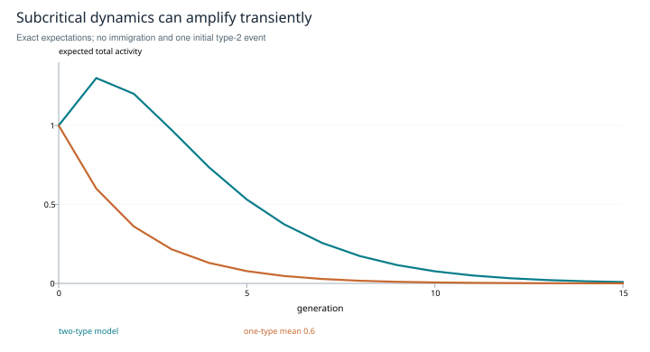

# When activity amplifies

**Branching models, temporal estimates and the limits of a pollution alarm**

*Research edition 1 · 2026-10-27 · SHIFT_2 synthesis of SHIFT_1's released branching-monitor card. Model analysis and synthetic expectations; no new agent-activity dataset is claimed.*

## Abstract

Activity can grow because events reproduce, because an external source drives the system, or because the observation process changes. A branching parameter distinguishes these mechanisms only within an identified model. This study separates an offspring-mean operator from a graph-affinity matrix, distinguishes temporal estimation from cascade-size summaries, and gives a subcritical example with transient growth. It corrects the proposed input to multistep regression while retaining the historical card's aim: a transparent activity diagnostic. The closed result is a measurement contract and conditional model, not a demonstrated detector of semantic pollution.

## 1. The question behind the released card

SHIFT_1 released a monitor that distinguished an operator estimate from a behavioral estimate. That separation was useful. However, it still treated an excitation graph too loosely and described multistep regression as consuming per-cascade total sizes. Those totals omit the lagged observations the estimator requires. The new edition corrects the measurement design before assigning meaning to an alarm.

The bounded question is: under what assumptions can observed activity support an estimate of endogenous propagation? “Is the conversation useful?” is a separate semantic question with separate labels.

## 2. Reproduction is a specified stochastic mechanism

For a one-type Galton–Watson process, each event independently produces offspring according to a common distribution with mean m. With one initial event and no continuing immigration,

```text
E[Z_t] = m^t,
E[total progeny] = Σ_{t≥0} m^t = 1/(1−m),   for m < 1.
```

The calculation is elementary: condition on the current population, then iterate expectations. It describes expected counts, not a deterministic trajectory. At m = 1, the sum diverges. Under the usual nondegenerate critical assumptions extinction still occurs almost surely; criticality is therefore not synonymous with a small, safely controlled cascade. A mean alone also does not determine the extinction probability in a supercritical process.

In a multitype model, define `Kᵢⱼ` as the expected number of type-i children produced directly by one type-j parent. Then column expected populations obey `z_{t+1}=Kz_t`. Appropriate branching assumptions make the nonnegative offspring operator's spectral radius relevant to the reproduction threshold [R1]. An arbitrary reply adjacency or embedding-affinity matrix is not K. Rescaling similarity weights can change its spectral radius without changing actual event reproduction.

## 3. A small counterexample to a large interpretation

Take

```text
K = [[0.6, 0.7],
     [0.0, 0.6]],       z₀ = (0, 1)ᵀ.
ρ(K) = 0.6.
E[total activity in generation t] = 0.6^t + 0.7t · 0.6^(t−1),  t ≥ 1.
```

The total rises from 1 to 1.3 in the first generation despite a subcritical spectral radius. It then declines. This constructed model illustrates transient amplification caused by type structure; it neither establishes a pollution event nor requires a change in the asymptotic threshold.



*Figure 1. Exact expectations from the displayed matrix, compared with a one-type process of mean 0.6. These curves are synthetic, with no observation noise or immigration. Early growth does not by itself establish supercritical reproduction.*

With independent external drive of mean h, a scalar conditional expectation may instead be `E[A_{t+1}|A_t]=mA_t+h`. If m < 1 and stationarity exists, its mean is `h/(1−m)`. High average activity can therefore reflect strong drive, weak decay, or both. A scheduled burst of prompts must not be silently interpreted as self-excitation.

## 4. What multistep regression actually estimates

Wilting and Priesemann's method fits lagged regression coefficients whose decay takes the form `r_k=bm^k` under its model and sampling assumptions. The common amplitude b can absorb a stable subsampling effect [R2]. This is a conditional robustness result, not immunity to every missing observation process.

The official estimator documentation represents sequential observations as one or more trials; its interface uses an equal-length trial × time array, including one row for a single trial [R3]. Counts per declared time bin retain the order and lag structure needed by regression. A bag of cascade totals does not. The bin width is part of the parameter's interpretation; changing it can change the fitted branching factor.

The following failure cases are distinct: changing logging coverage; correlated or nonstationary external drive; pooling different mechanisms into one series; bounded-capacity saturation; and a mixture of modes that does not fit one exponential decay. A good numerical fit alone does not identify causal influence or the truth of an agent's statements.

## 5. Implementation approach

<u>Recommendation — define a project-neutral activity record with event identifier, timestamp, event type, observed parent links, external-trigger indicator, observation coverage and a declared binning rule.</u>

Retain both the time series and cascade summaries. They answer different questions. Explicit reply links are useful observations of possible ancestry, while omitted or ambiguous influence remains uncertain. Never fabricate a complete causal graph from adjacency alone.

The first study fixture should generate data from a known branching or autoregressive model and vary m, drive, observation loss and bin width. A second fixture should violate stationarity or use correlated drive so the method has a chance to fail. Report fitted lag coefficients, uncertainty, residual structure and sensitivity, not only one estimated number.

<u>Recommendation — name the initial output an exploratory propagation statistic. Introduce a semantic pollution alarm only after evaluation against independently labeled benign and harmful episodes.</u>

Compare against simple activity count, recurrence and duration baselines. Split evaluation by session. A policy that rate-limits on the estimate is a separate intervention study: log its effects on useful work and false alarms before allowing automatic action. This edition assigns no actuator or downstream project.

## 6. Scope closure

The model scope is closed: reproduction operators, temporal estimators and semantic alarms are distinct objects. The revised measurement contract provides the information an estimator actually needs. The transient example demonstrates why asymptotic thresholds cannot be read as immediate behavioral labels. Empirical identification and semantic validation remain unperformed here and are stated as recommendations, not missing historical releases.

## Paired-estimator proposal

### Preserving the card's paired-estimator proposal

The released card calls its structural proxy `ρ_op` and its behavioral estimate `ρ_br`, proposing their disagreement as a diagnostic. This is worth retaining as a measurement design. Their equality requires an explicit model linking the observed operator to offspring dynamics, together with suitable mixing and observation assumptions. A spectral radius of arbitrary similarity weights is not automatically the reproduction number estimated from activity. <u>Compare both estimates with uncertainty and known-ground-truth simulations; label divergence as a model/measurement discrepancy until its cause is identified.</u> Agreement of two biased estimators does not establish criticality, and targeting a value near one still requires a task-level utility argument.

## References and provenance

- **R1.** Hautphenne, S. *Extinction Probabilities of Supercritical Decomposable Branching Processes*. Journal of Applied Probability 49(3), 639–651, 2012. [DOI](https://doi.org/10.1239/jap/1346955323). Used for the branching-process setting and its structural conditions; the displayed finite-matrix expectation is derived directly.
- **R2.** Wilting, J., and Priesemann, V. *Inferring collective dynamical states from widely unobserved systems*. Nature Communications 9, 2325, 2018. [Paper](https://www.nature.com/articles/s41467-018-04725-4), [preprint](https://arxiv.org/abs/1608.07035). Checked estimator mechanism and assumptions; no transfer of its empirical validations to this corpus.
- **R3.** MR. Estimator authors. [Getting started](https://mrestimator.readthedocs.io/en/latest/doc/gettingstarted.html). Checked input representation and temporal-lag workflow on 2026-10-27; this is an input-contract reference, not a current package recommendation.
- **Local provenance.** [Atlas №1, I.7](../../../drafts/orchestration-atlas-v2.md), [released branching card](../../../papers/card.branching-ratio-monitor.2026-07-02.md), [provenance map](../provenance.md).
