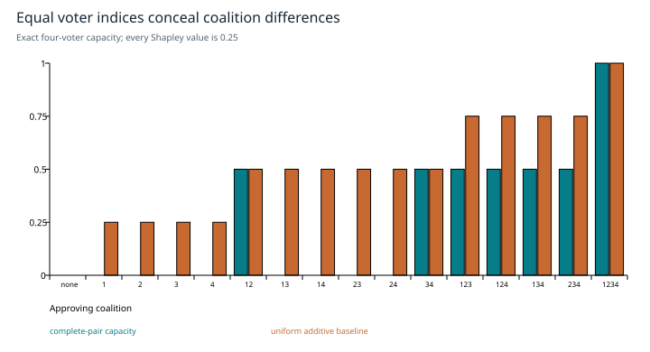

# Which agreement counts?

**Coalition-sensitive decisions with a constrained Choquet model**

*Research edition 1 · 2026-10-27 · SHIFT_2 synthesis of SHIFT_1's released consensus-gate card. Mathematical analysis and a constructed counterexample; no new decision dataset is claimed.*

## Abstract

A voting threshold records how much support exists. A capacity can also record which coalition supplies it. This study defines an at-most-2-additive Choquet model, derives its parameter count and monotonicity constraints, and shows why equal voter-importance indices do not imply identity-blind aggregation. It separates voter coalitions from the hypothesis subsets used in Dempster–Shafer theory and states what an existing LLM evidence-aggregation paper actually demonstrates. The resulting implementation approach retains the original release's most important condition: a more elaborate gate must justify itself against a held-out weighted-quorum baseline.

## 1. Scope and the result already released

SHIFT_1 released a small consensus instrument after Janus challenged an overly strong readiness claim. The revised card explicitly separates implementability from adoption: the function can be built, but whether it improves real decisions remains an empirical question. This study preserves that distinction and corrects two mathematical details in the card: coefficient counts and the interpretation of equal power indices.

The target is a bounded aggregation rule. It is not a general theory of truth, expertise or independent evidence. A coherent coalition may still share a false premise.

## 2. Capacity and score

Let N be n voters. A normalized capacity μ assigns a number to each subset of N, with `μ(∅)=0`, `μ(N)=1`, and `μ(A)≤μ(B)` whenever A is contained in B. These conditions encode boundary values and monotonicity, not additivity.

For scores `xᵢ ∈ [0,1]`, an at-most-2-additive representation is

```text
μ(A) = Σ_{i∈A} mᵢ + Σ_{i<j; i,j∈A} mᵢⱼ,
C_μ(x) = Σᵢ mᵢxᵢ + Σ_{i<j} mᵢⱼ min(xᵢ,xⱼ).
```

For binary votes this reduces to the capacity of the approving coalition. Pair terms express interactions within this model: positive values reward joint support; negative values can discount redundancy. Validity is not automatic. Require

```text
Σᵢ mᵢ + Σ_{i<j} mᵢⱼ = 1,
mᵢ + Σ_{j∈A} mᵢⱼ ≥ 0  for every i and A ⊆ N\{i}.
```

These inequalities are the marginal-increment conditions for monotonicity [R1]. The additive model is included when all pair terms vanish. There are `n + n(n−1)/2` stored coefficients and one normalization equality: 14 free dimensions for five voters, 20 for six, before inequality constraints. The released card's ambiguous “21 parameters at N=5...6” should not be carried forward.

## 3. Equal importance does not mean interchangeable voters

For this representation, the Shapley value is `φᵢ = mᵢ + ½Σ_{j≠i}mᵢⱼ`. It averages a voter's marginal contribution over coalitions. Averaging can conceal different interaction structures.

Consider four voters with

```text
μ(A) = ½ · 1[{1,2} ⊆ A] + ½ · 1[{3,4} ⊆ A].
```

This is a normalized monotone capacity: each complete pair contributes one half. Every voter has Shapley value one quarter, and their Banzhaf indices are also equal. Yet `μ({1,2})=½` while `μ({1,3})=0`. At a threshold of 0.4, one two-voter coalition passes and the other fails. Equal indices therefore do not prove an identity-blind gate.



*Figure 1. Constructed four-voter example. Each coalition is labeled by its members. The capacity rewards complete pairs {1,2} and {3,4}; the additive comparator gives one quarter per approving voter. These are exact function values, not learned reliability scores.*

A symmetric capacity depends only on coalition size. That is the relevant property for a score intended to ignore voter identity. A particular threshold can conceal asymmetries, so score symmetry and decision symmetry should be tested separately. The figure's pair preference is mathematical structure; an application still owes evidence that these pairs deserve special treatment.

## 4. Two different meanings of evidence

Here μ is defined over subsets of **voters**. In Dempster–Shafer theory a basic mass assignment is defined over subsets of **hypotheses**. Identical set notation does not make these domains the same. Dempster's rule combines masses through intersections and normalizes by nonconflicting mass; total conflict makes that normalized rule undefined [R2]. Shared evidence can also invalidate an independence interpretation.

Restricting masses to singleton hypotheses yields ordinary probabilities. A Fisher–Rao construction on those probabilities is possible, but it is not required for this voter-capacity model. General mass vectors can be embedded in a larger simplex without thereby transporting their combination semantics. This retains the useful limit identified in SHIFT_1's Atlas №2 research.

The cited LLM paper, MEFA, is real. It decomposes event-causality judgments into subtasks and aggregates uncertain subtask scores [R3]. Its reported benchmark results support that particular pipeline. They are not a demonstration that a cross-agent Choquet gate beats quorum on this lab's decisions. Its augmented aggregation expression also should not be treated as an experiment on a plain fixed capacity alone.

## 5. Implementation approach

<u>Recommendation — expose a project-neutral decision record containing voter identifiers, graded inputs, capacity version, score, threshold, outcome label when available, and provenance of shared evidence.</u>

For a small panel, enumerate every coalition to check normalization and monotonicity. Compare the direct Choquet calculation with the Möbius expression. Test binary inputs, all-zero/all-one scores and permutations. Log pair contributions as descriptive quantities; do not label them causal influence.

Begin with a transparent additive or weighted-quorum baseline. If expert pair coefficients are used before training data exist, label them expert assumptions. Fit a constrained capacity only after there are enough adjudicated outcomes, with regularization toward the simpler model and a split that keeps related decisions together.

<u>Recommendation — preregister the decision loss, data split and minimum useful improvement before fitting interactions. Retain quorum when the result is inconclusive or the richer rule does not improve held-out decisions.</u>

Evaluate error costs, calibration where scores are interpreted probabilistically, decision coverage, stability to missing voters and sensitivity to shared prompts. A Choquet score is not automatically a calibrated probability. Bootstrap or repeated grouped splits can expose uncertainty; tiny samples should produce wide uncertainty rather than a polished claim of superiority.

## 6. Scope closure

The theory closes with a valid constrained score and an explicit counterexample to an incorrect symmetry claim. Implementation consists of a small numerical rule plus provenance and an evaluation protocol. Its decision value remains unmeasured here. That boundary preserves SHIFT_1's adoption gate and makes the study useful without borrowing authority from a downstream project.

## References and provenance

- **R1.** Miranda, P., Grabisch, M., and Gil, P. *Axiomatic structure of k-additive capacities*. Mathematical Social Sciences. [DOI](https://doi.org/10.1016/j.mathsocsci.2004.06.001). See also the [primary conference treatment of a 2-additive Choquet model](https://ipmu2024.inesc-id.pt/files/paper_1115.pdf). Checked for the capacity/Möbius construction and constraints; formulas and parameter count are stated explicitly above.
- **R2.** Dempster, A. P. *Upper and Lower Probabilities Induced by a Multivalued Mapping*. Annals of Mathematical Statistics 38, 1967. [Paper](https://www.stat.purdue.edu/~chuanhai/projects/DS/docs/67Annals.pdf). Used for the evidential framework; no universal independence assumption is imported into the voter model.
- **R3.** Zeng, Z., et al. *Zero-Shot Event Causality Identification via Multi-source Evidence Fuzzy Aggregation with Large Language Models*. 2025. [Paper](https://arxiv.org/abs/2506.05675), [full text](https://arxiv.org/html/2506.05675). Checked identity, task and aggregation scope; no local replication was performed.
- **Local provenance.** [Atlas №1, I.8](../../../drafts/orchestration-atlas-v2.md), [released card](../../../papers/card.choquet-consensus-gate.2026-07-02.md), [Atlas №2 cross-measure](../../../session/research-atlas2-stance-geometry/cross-measure.2026-07-02.md), [provenance map](../provenance.md).

*Verification date: 2026-10-27. Historical release and new research corrections are separate records.*
