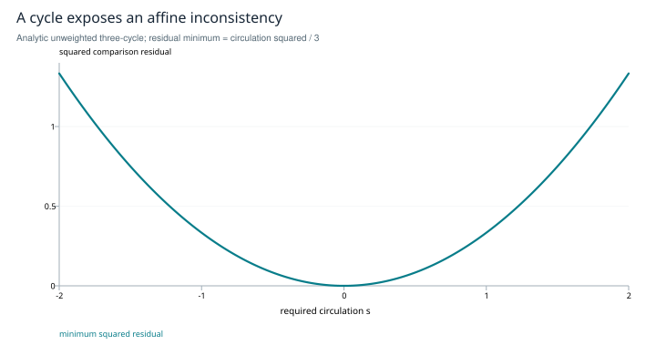

# Agreement, composition and the model boundary

**What three formal frameworks can establish about one system**

*Research edition 1 · 2026-10-27 · SHIFT_2 synthesis of SHIFT_1's fourth-spine research. Worked mathematical examples and a bounded literature check; no new safety or cross-vendor validation is claimed.*

## Abstract

Sheaf consistency, typed composition and variational free energy address different questions. A sheaf asks whether local representations agree under chosen maps. A wiring grammar asks whether specified interfaces compose under declared semantics. Variational free energy evaluates inference within a specified probabilistic model. This study makes those distinctions explicit, derives a small inconsistent-cycle example and explains why none of the three certifies semantic truth. The resulting implementation approach preserves the Atlas's interest in system coherence while replacing an unspecified universal health scalar with separately validated measurements.

## 1. Scope and inherited result

SHIFT_1's fourth spine connected sheaves, Markov blankets, operads and stopping under the idea of maintaining one system. The Atlas №2 research subsequently rejected the literal sphere-as-linear-stalk construction and retained a narrower typed program. That is useful prior work. This study closes the formal scope of coherence and composition; geometric stance measurement and stopping are treated in their own reading editions.

The question is what a consistency result actually guarantees, and what evidence is still needed before acting on it. A precise formal result can coexist with a wrong interpretation of the underlying text.

## 2. Linear consistency needs a nontrivial question

For a graph with finite-dimensional vertex and edge spaces, let B map vertex assignments to edge discrepancies under the chosen restriction maps. With Euclidean inner products, define `L = BᵀB`. Then

```text
xᵀLx = ||Bx||²,
H⁰ = ker B = ker L.
```

These are the compatible assignments of the linear model. Zero is always one of them. Nontrivial H⁰ is therefore not itself a contradiction, and “no global section at all” is not the correct diagnosis for a homogeneous linear sheaf. Discourse-sheaf dynamics explicitly includes the possibility of convergence to zero when no nontrivial sections exist [R1].

A useful question fixes observations or introduces affine requirements: can `Bx=b` be solved? On a graph, b has an obstruction precisely when its class in `C¹/im B` is nonzero. Alternatively, fix part of x and minimize the residual of its extension. Both formulations say which information must be preserved.

## 3. A cycle that cannot satisfy its own differences

Take three scalar states and orient a cycle 1→2→3→1. Its incidence operator returns `(x₂−x₁, x₃−x₂, x₁−x₃)`. Every such vector sums to zero. Required differences `b=(1,1,−1)` sum to one, so they cannot all hold.

The minimum squared residual is the squared norm of the component of b along the all-ones vector. If `s=b₁+b₂+b₃`, then

```text
min_x ||Bx−b||² = s²/3.
```

For the stated b the minimum is 1/3. One minimizing assignment is `(0, 2/3, 4/3)`, giving residual `(-1/3, -1/3, -1/3)`. By contrast `b=(1,1,−2)` is consistent. This is an exact algebraic obstruction under declared comparisons, not a detector of contradictory natural language without a measurement map.



*Figure 1. Analytic illustration for the unweighted scalar three-cycle. Required circulation s has minimum squared residual s²/3. Different weights or comparison maps define a different problem; no semantic labels are present in these data.*

An implementation must also test map collapse. If a comparison map sends every claim to zero, the residual vanishes while all information is lost. Anchors, observability or information-preservation conditions are therefore part of the measurement contract. A small residual alone does not prove shared meaning or truth.

## 4. A well-typed composition can behave badly

Operadic wiring gives a disciplined way to compose systems with declared interfaces and semantics. Dynamical systems can be assigned as algebras over such wiring structures [R2]. This is stronger than drawing boxes, but its guarantee remains relative to what the boxes and wires mean.

Two components can both accept and return a score in [0,1] while interpreting it differently: one as confidence in a claim, another as urgency to inspect it. A bare numeric type admits the connection even when the meanings conflict. Enriching the interface can prevent that error, but it still does not prove liveness, latency, stability or factual correctness. Those require behavioral assumptions and separate checks.

<u>Recommendation — define project-neutral ports with units, semantic meaning, uncertainty, provenance, allowed failure values and timing assumptions. Treat composition validity and behavioral validity as separate acceptance questions.</u>

The relevant deliverable is a contract that another project can inspect, not an imposed architecture or a claim that a type system settles the research question.

## 5. Free energy is relative to a model

For a specified joint probability model p(o,z), observation o and approximate posterior q(z), with appropriate support, variational free energy is

```text
F(q,o) = E_q[log q(z) − log p(o,z)]
       = KL(q(z) || p(z|o)) − log p(o).
```

The identity provides an upper bound on negative log model evidence [R3]. It does not certify that the model is appropriate. Even with q equal to the exact posterior, two models assigning different probabilities to the same observation give different free energies. A model can confidently encode a false assumption.

A Markov blanket is a conditional-independence structure in a probabilistic model. Calling files “inside” and streams “outside” does not establish that structure. It may suggest an architectural boundary worth modeling; the independence claim still needs a defined distribution and a check.

The Atlas's recent citations also have different evidential status. *Orchestrator* reports a framework tested on maze puzzles [R4]. The language-mediated active-inference paper proposes an architecture and future validation [R5]. *Markov Blanket Density and Free Energy Minimization* proposes a density-based extension [R6]; its abstract does not support the Atlas's characterization of that citation as a restrictive critique of the free-energy principle. None is imported here as a general safety guarantee.

## 6. Implementation approach and the health question

<u>Recommendation — expose three separate outputs: constrained comparison residuals, interface/behavioral contract results, and model-relative probabilistic scores. Preserve their assumptions instead of compressing them immediately into one health number.</u>

For comparison maps, use known synthetic transformations and deliberately inconsistent cycles, then held-out labeled claims. Test both false conflict and false agreement, including collapsed maps. For composition, test timing, failure propagation and semantic units in addition to type matching. For probabilistic models, measure calibration and predictive performance under distribution change.

A scalar health score can later be an empirical risk model. It needs a target outcome, calibration data, missing-value handling and a decision threshold with stated costs. A stable, mutually consistent set of agents can agree on a false answer; every proposed structural diagnostic can look favorable in that case. The benchmark must contain such false-safe examples.

## 7. Scope closure

The study closes with three bounded guarantees and their limits: agreement under specified maps, composition under specified semantics, and inference under a specified probability model. Their combination is a research design, not an established common energy law. The implementation recommendations remain abstract and project-neutral until an operator assigns a downstream scope.

## References and provenance

- **R1.** Hansen, J., and Ghrist, R. *Opinion Dynamics on Discourse Sheaves*. [Full text](https://arxiv.org/html/2005.12798). Checked linear comparison and global-section interpretation. The affine-cycle calculation above is derived directly.
- **R2.** Libkind, S., Baas, A., Patterson, E., and Fairbanks, J. *Operadic Modeling of Dynamical Systems: Mathematics and Computation*. ACT 2021. [Paper](https://jamievicary.github.io/act2021/papers/ACT_2021_paper_53.pdf). Author list corrects the earlier shorthand that omitted Baas; used for specified wiring and dynamical semantics.
- **R3.** Friston, K. *The Free-energy Principle: A Unified Brain Theory?* Nature Reviews Neuroscience 11, 127–138, 2010. [Publisher](https://www.nature.com/articles/nrn2787). Used for the model-relative variational framework; no universal semantic interpretation is assumed.
- **R4.** Beckenbauer et al. *Orchestrator: Active Inference for Multi-Agent Systems in Long-Horizon Tasks*. [arXiv:2509.05651](https://arxiv.org/abs/2509.05651). Abstract-level verification of evaluation scope.
- **R5.** Wen, B. *A Framework for Inherently Safer AGI through Language-Mediated Active Inference*. [arXiv:2508.05766](https://arxiv.org/abs/2508.05766). Abstract-level verification; treated as a proposal.
- **R6.** Possati, L. M. *Markov Blanket Density and Free Energy Minimization*. [arXiv:2506.05794](https://arxiv.org/abs/2506.05794). Abstract-level verification; the paper's proposed extension is not independently validated here.
- **Local provenance.** [Atlas №1, fourth spine](../../../drafts/orchestration-atlas-v2.md), [Atlas №2 cross-measure](../../../session/research-atlas2-stance-geometry/cross-measure.2026-07-02.md), [provenance map](../provenance.md).

*Verification date: 2026-10-27. This research edition does not claim cross-vendor runtime verification, formal safety certification or a new project lock.*
