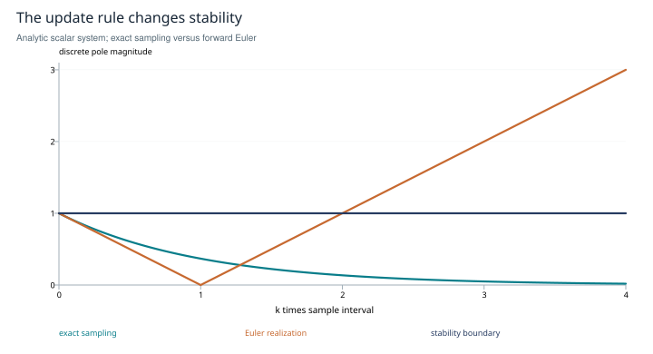

# Before the controller acts

**Identifiable diagnostics, sampled feedback and stopping under an explicit loss**

*Research edition 1 · 2026-10-27 · SHIFT_2 synthesis of SHIFT_1's Atlas research directions B1–B4 and B12. Counterexamples and analytic models; no fitted agent controller or stopping experiment is claimed.*

## Abstract

The language of curl, damping and stopping is useful only after the measured state and governing model are specified. This study establishes three boundaries. A single trajectory does not identify a surrounding vector field or its curl. Stable distributed agreement does not require a dominant central agent. A stopping policy is optimal only for its stated information, costs and loss. We give counterexamples and a sampling calculation that turn these boundaries into testable requirements. The result is a project-neutral implementation approach for diagnostics and decision policies, with negative findings treated as legitimate study outcomes.

## 1. Scope and inherited research

SHIFT_1's Atlas proposed curl and material-derivative diagnostics, a gravitational justification of central orchestration, a critical-damping tuner and an optimal-stopping layer. Its split-map left these as research directions rather than four completed empirical instruments. A later ledger chose the curl detector as a research priority; this edition does not activate that implementation queue.

The present scope is what the available mathematics permits one to infer. It closes with explicit counterexamples, model conditions and evaluation designs. It does not claim to measure psychological reconsideration, hallucination or task completion from geometry alone.

## 2. A trajectory does not identify curl

On the line y = 0, the planar fields

```text
F₁(x,y) = (1, 0),
F₂(x,y) = (1 + cy, 0)
```

give the same observed straight motion, with c any fixed nonzero constant. Their scalar curls `∂F_y/∂x − ∂F_x/∂y` are respectively 0 and −c. Thus an observed path does not identify transverse derivatives. Even a nonzero curl need not produce a loop along that path.

The converse slogan also fails. On the punctured plane, with `r²=x²+y²`, the field `F=(-y/r², x/r²)` has zero curl but circular integral curves. The missing origin and domain topology matter. Neither example concerns semantic reasoning; they show why the proposed analogy needs additional structure before it can be interpreted.

The cited MDP calculus supplies a more precise graph construction: discounted curl compares reward integrals along paired two-step paths with common endpoints, called diamonds. Its converse result needs diamond-completeness [R1]. A lone sequence of text outputs does not supply those alternatives or an identified reward.

The material derivative `DQ/Dt = ∂Q/∂t + v·∇Q` is a kinematic identity once Q, coordinates and v are defined. The terms do not automatically separate “changed one's mind” from “was socially carried.” A causal interpretation would need interventions or additional identifying assumptions.

A temporal power spectrum is a different diagnostic. Periodicity in a declared scalar or vector observable can reveal recurrence, but it does not distinguish productive revisits from harmful repetition without labels. The time coordinate, sampling rate, window and treatment of irregular intervals must be recorded; otherwise a peak can reflect the observation schedule. A phasor representation likewise needs a justified periodic stance variable. Neither a periodic peak nor a phase angle establishes semantic opposition by itself.

<u>Recommendation — begin with observable recurrence and annotated outcomes. Introduce a field-based diagnostic only when its sampling design identifies the required derivatives or comparative transition structure.</u>

## 3. Centrality is an architectural choice, not a consequence of gravity

Let L be the Laplacian of a connected undirected cycle and let numeric states obey `ẋ = −Lx`. The constant mode is preserved; every positive-eigenvalue mode decays. The states converge to their initial mean without a dominant node. This supplies a direct counterexample to the claim that mutual interaction requires a central mass to become stable. Distributed consensus has an established literature with explicit graph and delay conditions [R2].

The example proves agreement, not truth. A central controller may still be useful for ownership, scheduling or arbitration, but those are arguments about requirements and failure modes. An unspecified Newtonian metaphor cannot replace them.

## 4. Sampling changes the feedback question

For the continuous scalar model `ẋ = −kx`, k > 0, exact sampling at interval h gives `x_{n+1}=exp(−kh)x_n`, which is asymptotically stable for every h > 0. A forward-Euler realization instead gives `x_{n+1}=(1−kh)x_n`, asymptotically stable only when `0 < kh < 2`. At kh = 2 it alternates without decay; kh = 0 is also a boundary case.



*Figure 1. Analytic pole magnitudes for the displayed scalar model. The Euler curve exceeds the stability boundary at kh > 2; exact sampling remains inside it. This is a mathematical illustration, not evidence that an agent loop uses either realization.*

This distinction prevents a common confusion: sampling a stable trajectory is not the same operation as constructing a sampled controller or numerical update. Real feedback adds observations, actuation, delay, saturation and possibly irregular intervals. Networked-control results analyze such effects under stated models [R3].

Critical damping likewise belongs to a specified second-order equation, such as `ẍ + 2ζωₙẋ + ωₙ²x = u`. A “fastest settling” claim needs a fixed natural frequency, an input and initial condition, an overshoot constraint and a settling criterion. A capacitor or inductor alone is not a complete high-pass or low-pass filter specification. For a discrete linear closed loop, the stability condition concerns eigenvalues inside the unit circle, not continuous-time poles in the left half-plane.

<u>Recommendation — specify a project-neutral controller contract containing measured state, observation uncertainty, actuator, delay, sampling rule, saturation and loss before fitting or tuning a feedback model.</u>

## 5. Stopping needs an objective and an information boundary

A stopping time τ can use only information available by the moment it stops. A generic objective might minimize expected task loss plus cost, `E[L(a_τ,Y)+cτ]`, where Y is an adjudicated outcome and a is the final decision. This is a problem definition, not yet an optimal policy. Costs may be nonconstant, and backtracking adds actions beyond “stop or sample again.”

The cited recent papers address different versions of this problem. BEACON balances modeled response-quality improvement against sampling cost [R4]. Work on consistent answers studies identifying a modal answer under a probabilistic sampling model [R5]. A heterogeneous-LLM sequential-testing paper studies binary classification with differing accuracies and costs; its title changed between the April and September 2026 versions [R6]. These are relevant research leads, not a universal theorem about when a whole scientific investigation should end. Repeated agreement can be confidently wrong.

<u>Recommendation — define the task loss and available information before choosing a stopping rule. Compare against fixed budgets and simple confidence rules on held-out tasks, including correlated responses and miscalibrated scores.</u>

Report cost–quality curves, premature-stop errors, delay, sensitivity to the cost parameter and performance under model misspecification. If a stopping rule relies on independent samples, test that assumption rather than treating repeated prompts as independent by default. Any claimed optimality must name the model and objective it optimizes.

## 6. Implementation approach and scope closure

### Remaining Atlas mappings, made explicit

For a differentiable declared score Q, the gradient points in the local steepest-ascent direction under the chosen metric. Calling this useful steering additionally requires Q to represent task success and the actuator to realize the suggested move. Divergence measures net outward flux density of a specified vector field. Positive divergence in a low-Q region is not a theorem about hallucination: neither conservation of information nor a semantic source model has been established. <u>Test the score and local flow estimates against labeled task outcomes before interpreting either as a reasoning diagnostic.</u>

The RLC analogy becomes concrete only after choosing a circuit and output. For a series RLC circuit driven by voltage V_in, with output across the capacitor, `LC·V̈_C+RC·V̇_C+V_C=V_in` and `H_C(s)=1/(LCs²+RCs+1)`. For positive L,C,R this is a low-pass example, with `ω_n=1/√(LC)` and `ζ=(R/2)√(C/L)`. Across the resistor the numerator is RCs (band-pass); across the inductor it is LCs² (high-pass). Thus “C is high-pass, L is low-pass” is not a component-only law. Assigning agent summaries to R and memory to C does not identify any of these parameters; fitting a causal response model and testing it comes first.

Likewise, low temporal frequency is not inherently coherence, a sharp peak is not inherently a loop, and broad spectral power is not inherently creativity. Those proposed signatures need labeled observations and matched sampling. The distributed-consensus counterexample in §3 is a Laplacian model, not a solution of Newtonian n-body dynamics; it refutes the necessity of central control for agreement, not every claim one could make about a specified gravitational model.

The minimum experiment suite has three separate fixtures: a field-identification test with deliberately indistinguishable trajectories; a feedback model with controlled sampling and delays; and a decision process with known losses and response dependence. Passing one fixture supplies no evidence for the other two. Only then should the interfaces be connected into a policy.

The study closes with a clear negative result for the strongest analogies and a constructive path for their useful parts. Curl is not identified by one path. Central orchestration is not mathematically necessary for distributed agreement. Critical damping and optimal stopping are conditional results. These findings narrow the implementation question without assigning it to another project or reopening an old build gavel.

## References and provenance

- **R1.** Jenner, E., van Hoof, H., and Gleave, A. *Calculus on MDPs: Potential Shaping as a Gradient*. [Full text](https://arxiv.org/html/2208.09570). Checked diamond definition and conditions on the curl converse.
- **R2.** Olfati-Saber, R., and Murray, R. M. *Consensus Problems in Networks of Agents with Switching Topology and Time-Delays*. IEEE Transactions on Automatic Control 49(9), 1520–1533, 2004. [Author-hosted record](https://www.cds.caltech.edu/~murray/papers/2003f_om04-tac.html). Used for distributed-consensus lineage; the cycle proof is given above.
- **R3.** Hu, L., Bai, T., Shi, P., and Wu, Z. *Sampled-data Control of Networked Linear Control Systems*. Automatica 43(5), 903–911, 2007. [Institutional record](https://vuir.vu.edu.au/3304/). Abstract-level verification only; the scalar sampling calculation above is independent of its theorem.
- **R4.** Wan et al. *BEACON: Bayesian Optimal Stopping for Efficient LLM Sampling*. [arXiv:2510.15945](https://arxiv.org/abs/2510.15945). Identity and abstract-level scope checked.
- **R5.** Huang, Ma and Zhou. *Optimal Bayesian Stopping for Efficient Inference of Consistent LLM Answers*. [arXiv:2602.05395](https://arxiv.org/abs/2602.05395). Identity and abstract-level scope checked; consistency is not equated with correctness.
- **R6.** Li et al. [arXiv:2604.01086](https://arxiv.org/abs/2604.01086). Current title: *Sequential Sampling for Binary Classification: Two LLMs are (Almost) All You Need*. [Version 1](https://arxiv.org/html/2604.01086v1) was titled *Asymptotically Optimal Sequential Testing with Heterogeneous LLMs*. Abstract-level verification; no general two-agent sufficiency claim.
- **Local provenance.** [Atlas №1](../../../drafts/orchestration-atlas-v2.md), [three-spine narrative](../../../drafts/three-spines-orchestration.md), [split-map](../../../session/split-map.2026-07-02.md), [provenance map](../provenance.md).

*Verification date: 2026-10-27. No agent-loop intervention, numerical controller fit or stopping-policy benchmark was performed.*
