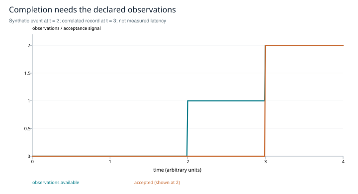

# Interactive interposition: transport, observation and completion

**Inner-circle research edition · SHIFT_1 evidence, SHIFT_2 protocol refresh · 2026-10-27**

## Abstract

A terminal can transport input to an interactive agent without reliably identifying a completed, correlated turn. This study separates injection, rendered output, lifecycle events and response records. It reconstructs SHIFT_1's move from terminal-marker detection to hooks and transcript correlation, and checks current primary documentation for PTYs, hooks, ACP and tmuxlet. The resulting contribution is a completion specification and a comparative experiment design. Historical prototype assertions are retained as reported evidence, not newly reproduced results. Policy, billing and downstream operation are outside this technical conclusion.

## Evidence and layers

The [interposition study](../../../drafts/interposition-study.md) proposes a file boundary and a tmux-managed pseudoterminal. Its [terminal-onion companion](../../../drafts/terminal-onion-study.md) distinguishes rendering, terminal and process layers. The [July research snapshot](../../../session/research-interposition-fullrange/epoch.findings.2026-07-07.md), [released card](../../../papers/card.interposition-driven-mode.2026-07-07.md) and [August sidecar](../../../session/research-interposition-fullrange/status.gavel-loop-A.2026-08-02.md) supply the subsequent research and disposition. All five documents were read in full; the code and historical runtime were not inspected or executed.

A PTY couples two endpoints: controller writes become terminal input and application output becomes available to the controller. The exchange is asynchronous and terminal modes matter. It is a compatibility surface, not a universal API or proof that automation is supported by every application. [Linux `pty(7)`](https://man7.org/linux/man-pages/man7/pty.7.html).

“Text all the way down” is a useful prompt for decomposition but an incomplete machine model. Streams are bytes interpreted under encoding and terminal-control conventions. A rendered pane may omit history or redraw earlier output. JSONL does not alone guarantee append-only behavior, completeness, durability or stable schema.

The July card reports a runnable seed and a locally observed transcript schema. It uses pane input, `SessionStart` for session discovery, `Stop` for a completion event and a nonce-bearing user record to locate response content. Those are historical assertions, not reproduced observations here. A locally accepted adoption decision does not establish downstream receipt or operation.

## A completion specification

For request k let I_k be the injected input, S its session, n_k its unique nonce, E an event and R a candidate response. A conservative acceptance specification is:

```text
accept(k) = sameSession(E, R, S)
            AND followsInput(R, I_k)
            AND correlates(R, n_k)
            AND terminalForTurn(E, R, k)
```

These predicates require an observable contract; writing them is not an implementation proof. A nonce found in terminal output may be an echo of the input rather than a response. Two underlying histories can produce the same visible marker, so the marker alone cannot identify its origin. Serializing requests per session helps but does not eliminate stale events, duplicate retries or concurrent human input.



*Figure 1. Synthetic timeline. An input is observed at time 0, a terminal event at 2 and a correlated response record at 3. The conjunctive specification accepts at 3; event-only observation at 2 has not yet established the response record. Times are arbitrary model units, not measured latency.*

If t_E and t_R are the observation times for a valid event and response, this simple two-observation design cannot accept earlier than `max(t_E,t_R)`. A trustworthy structured response may combine them into one observation. No finite timeout alone distinguishes a slow turn, interruption, lost event or hang.

## Primary-source refresh

Current Claude Code documentation distinguishes normal `Stop`, interruption and API-failure handling. It documents `last_assistant_message` and pending background work; a stop event need not mean that all session activity has ended. Hooks can also cause continuation. The historical transcript flush race must therefore be treated as a version-specific observation to test, not a timeless contract. [Claude Code hooks reference](https://code.claude.com/docs/en/hooks).

<u>Evaluate the documented hook payload as a content source, and use transcript correlation where required by the desired fields and observed version. Represent disagreement or delay explicitly as uncertain.</u>

ACP v1 specifies a response to `session/prompt` containing a `stopReason`; `end_turn` is one outcome, not a synonym for cancellation or all failures. ACP describes a client–agent protocol, while a particular adapter's use of an SDK or authentication scheme is a separate implementation choice. It supplies a structured option for compatible agents, not an event retrofitted onto every interactive terminal. [ACP prompt-turn specification](https://agentclientprotocol.com/protocol/v1/prompt-turn).

The August follow-up left tmuxlet's completion mechanism unknown. Its current maintainer documentation describes a contract in which an agent writes an answer file and invokes `tmuxlet bridge complete`, with separate blocked, timeout and exited outcomes. This closes a documentation-level question about its currently described approach. It does not reproduce its reliability or establish how a historical version behaved. [tmuxlet documentation](https://github.com/truefrontier/tmuxlet).

The original snapshot and August sidecar describe a hook-free, PTY-pure novelty niche; the released July card uses hooks. That is a substantive change of mechanism. The publication therefore makes no claim to a demonstrated unoccupied hook-free niche. It studies transport and correlation independently of that obsolete framing.

## Implementation approach and experiment

<u>Compare terminal-marker observation, lifecycle hooks, an explicit completion contract and an available structured protocol in a version-pinned, attended trial.</u> Keep a request ledger with session, nonce, injection time and observation provenance. Define states for accepted, uncertain, blocked, timed out and failed; deduplicate by request identity. Record transitions rather than overwriting evidence.

Use independently labeled timelines for ordinary replies, large multiline inputs, tool calls, permission prompts, interruptions, exits, duplicate events, stale sessions and delayed records. Keep interface differences visible instead of forcing false equivalence. Measure false completions, missed completions, wrong-turn/wrong-session association, observation latency and the rate of uncertain outcomes. Retain failures in denominators and provide uncertainty intervals. Compare cancellation behavior separately from successful response completion.

A file adapter can isolate change and a canary can reveal some regressions. Neither prevents vendor changes. Repeated version-pinned trials estimate breakage for the sampled versions; they do not determine a universal probability of future shifts.

## Limits and closure

The present research closes the conceptual distinction between transport and completion and refreshes the documented ACP/tmuxlet alternatives. It does not close empirical reliability, all vendors' interfaces, or the full historical MAKE-RESEARCH request. The old policy and billing conclusions are time-sensitive and were not re-established. <u>Refresh the relevant primary terms and account-specific economics before using those conclusions in an operational decision.</u>

No seed was run, no code was reviewed, and no receiving project was inspected. The output stands as a technical publication and a falsifiable test design; alignment and adoption remain later work.
