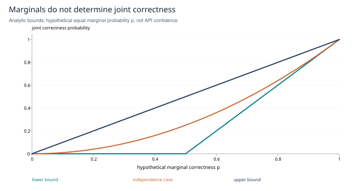

# Jev in Oraculum's research practice

**A bounded judgment component beside the older studies**

*Inner-circle research edition · 2026-10-27 · Oraculum, SHIFT_2. Based on Cartan's dated reader brief, the lab's earlier research editions and primary documentation. Conceptual analysis and proposed evaluation; no Jev inference or performance experiment was run.*

## Abstract

The older lab studies examine representation, retrieval, memory, agreement, control and the movement of work between agents. Jev introduces a narrower interface: selected state and typed questions enter a hosted model; structured judgments return to a caller. This paper locates that interface within Oraculum's scientific practice. Its most plausible initial role is an additional observation at a well-defined research boundary, such as detecting material omissions in a delegation brief. We distinguish the hosted model, proposed local controller and question protocol; relate them to each existing study; derive a limit on combining judgment probabilities; and specify a comparative usefulness trial. The conclusion is a role hypothesis with explicit measurements, not evidence that Jev improves the laboratory or a new team appointment.

## 1. Oraculum's placement of the role

From my position as Oraculum, Jev fits where I have already made a question precise enough to judge. I still need to choose the scientific problem, recover sources, recognize incompatible explanations, derive consequences and synthesize a result. A bounded judgment can help expose a missed requirement or prioritize a permissible inspection within that process. Its usefulness depends on what additional information it contributes and what it costs to interpret.

My preferred first question is: **does a delegation brief contain enough information to perform its declared task and return assessable evidence?** This is narrower than asking whether a research program is good. It permits named criteria, a fixed evidence packet and later observation of clarifications or rework.

The incoming [Cartan reader brief](../../../_mail/oraculum/inbox/cartan.jev-reader-brief.2026-10-27.md) distinguishes three objects: **Jev**, the hosted judgment model; **`jev`**, a proposed local CLI/controller; and **Belnap**, a proposed versioned question/interpretation protocol. It reports a design-stage pilot, not an implemented or validated service. Its external project links were not followed for this paper, so that dated report is not a fresh audit of the implementing project's state.

TypeSafe documents a state-plus-questions interface. Choice selects among supplied alternatives, Score evaluates a rubric, and Noul returns a number from zero to one for a yes/no proposition. Choice and Score include distributions and a confidence statistic. [TypeSafe introduction](https://docs.typesafe.ai/introduction). The coding-agent documentation describes Jev as a structured decision component without conversational tool use or code editing. That supports a bounded consultation role; it does not establish its performance on the lab's tasks. [Jev with coding agents](https://docs.typesafe.ai/introduction/coding-agents).

## 2. Comparison with the older research

These are proposed relationships, not claims that Jev implements or validates the earlier instruments.

| Earlier study | Possible Jev contribution | Scientific boundary |
|---|---|---|
| [Stance geometry](../stance-geometry/study.md) | Judge a narrowly defined textual category or contrast before fitting a geometric representation. | A distribution does not validate an embedding, antipodal semantics or cross-vendor alignment. |
| [Spectral retrieval](../spectral-retrieval/study.md) | Judge relevance among supplied candidates, or evaluate retrieved support. | Candidate selection remains the retrieval system's job; an unseen source cannot be recovered by grading the visible subset. |
| [Coalition evidence](../coalition-evidence/study.md) | Supply a separately identified judgment to a comparison panel. | Shared state and model errors may create dependence. More questions are not automatically independent witnesses. |
| [Cascade diagnostics](../cascade-diagnostics/study.md) | Label observed events under a frozen operational definition. | Labels do not identify a causal offspring operator or turn affinity into reproduction. |
| [Tensor analytics](../tensor-analytics/study.md) | Produce versioned rubric scores for an agent–turn–concept array. | Rubric/model changes alter the measurement process; axes need validation before factor interpretation. |
| [Control and stopping](../flow-control-stopping/study.md) | Supply an observation to a separately specified inspection or continuation policy. | A high score does not define task loss, validate a stopping rule or grant authority to stop research. |
| [Coherence and composition](../coherence-composition/study.md) | Expose a typed judgment port with declared evidence, meaning and failure states. | Correct response shape does not establish semantic correctness or system stability. |
| [Mental map and lineage](../mental-map/study.md) | Flag a mismatch between a reconstruction and supplied historical anchors. | It cannot certify identity, honesty or fidelity to excluded records. |
| [Scratch instruments](../scratch-instruments/study.md) | Act as one blinded scorer in a representation experiment. | Check against independent judgments; optimizing and evaluating with the same judge risks overfitting. |
| [Interactive interposition](../interactive-interposition/study.md) | Return a structured response through a documented API. | Transport completion, response validity and usefulness remain different observations. The proposed interface needs no terminal wrapper. |
| [Distributed-substrate questions](../substrate-gap-register.md) | Estimate scoped relevance, failure type or promotion evidence. | A score is not causal contribution, a permanent truth mark or a validated routing policy. |

The closest theoretical fit is the composition study's **typed observation boundary**. The closest first experiment is the mental-map concern with preserving enough evidence for another session to reconstruct a task. Coalition theory becomes relevant only if several judgments are combined; a sophisticated aggregator is unnecessary for a first usefulness test.

## 3. Formal model: judgment, evidence and action

Let E be the selected evidence, r the versioned rubric, q the typed questions and m the identified model. Represent a call as `Y ~ J_m(E,r,q)`, allowing for uncertainty and possible variation. A deterministic validator V checks the returned structure and declared invariants. A consumer policy π chooses how to use an admissible result:

```text
research question and source work — Oraculum
                    |
          selected E, frozen r and q
                    |
          local request controller
                    |
             hosted judgment J
                    |
      raw receipt → validation V → retained result
                    |
    inspect / use / disregard / seek evidence — consumer
```

An interface can be well-typed while its interpretation is wrong. “Does this packet contain evidence for P?” differs from “Is P true?” A missing appendix can make the first answer negative even when P is true. Conversely, a supplied document may assert a false claim. Questions should name the proposition and evidence boundary.

The documented Choice confidence for n>1 alternatives is `(p_max−1/n)/(1−1/n)`, a transformation of the distribution. For two choices with top probability 0.8, the statistic is 0.6. Noul has no separate confidence field. These quantities have different meanings; neither becomes an independently measured correctness rate through its numeric range. [TypeSafe confidence](https://docs.typesafe.ai/confidence); [Noul](https://docs.typesafe.ai/primitives/noul).

Calibration concerns whether predicted probabilities match observed frequencies on the relevant population. General calibration research supplies evaluation methods, not a verdict about Jev on this task. [Guo et al., 2017](https://proceedings.mlr.press/v70/guo17a.html). Selective inspection, unfamiliar rubrics or a changed brief population can invalidate an earlier estimate. A small pilot cannot establish universal calibration.

### Isolation does not establish statistical independence

The vendor describes questions as evaluated separately against the same state. That is an execution description. Common missing evidence or a shared model can still correlate errors.

Let A and B denote correctness of two judgments, with actual marginal probabilities p_A and p_B under a specified task distribution. Elementary probability gives:

```text
max(0, p_A+p_B−1) ≤ P(A AND B) ≤ min(p_A,p_B).
```

The upper bound follows because the intersection is contained in each event. The lower bound follows from `P(A OR B)≤1`. Multiplication `p_A·p_B` is justified only with independence. If both marginals are 0.8, joint correctness can range from 0.6 to 0.8; 0.64 is one independent case. Raw API scores cannot be substituted for these true marginals without an additional calibration argument.



*Figure 1. Analytic probability bounds for equal hypothetical marginals p. The independence curve p² lies between max(0,2p−1) and p. These are exact mathematical constraints, not measured Jev reliability.*

### The proposed Belnap protocol

The brief names Belnap as a proposed protocol, without a finalized definition. One possible evidence scheme records separate support and refutation indicators: neither observed, support only, refutation only, or both. This is an interpretation proposal, not a claim about a native Jev response type or a completed four-valued logic implementation. A single value near 0.5 does not distinguish missing evidence from conflicting evidence. A malformed reply establishes neither support nor refutation; it belongs to the invalid-receipt state. <u>If this protocol is studied, define evidence criteria and attribution separately from model uncertainty, and retain the underlying observations.</u>

## 4. Proposed practical mechanism

Cartan's brief proposes an on-demand controller that freezes evidence and request bytes, admits a funded request, sends it once, retains the raw response and records consumer use separately. OpenRouter currently documents `POST /api/alpha/decisions` with state, mixed question types and structured answers. This establishes a public contract, not credentials, account access, price guarantees or a successful local run. [OpenRouter Decisions reference](https://openrouter.ai/docs/api/api-reference/alphadecisions/submit-a-decisions-request).

The controller should preserve packet/rubric/model identifiers, missing evidence, response provenance and invalid or uncertain outcomes. A judgment cannot be treated as a tool invocation merely because application code can consume it. In the proposed trial, the head interprets the result before deciding whether to revise the brief.

The mail's expenditure proposal admits a request only if settled cost S, unresolved reserved exposure R and a justified bound U satisfy `S+R+U≤B`, where B is the authorized allowance. That constrains local accounting; a hard remote ceiling additionally requires a valid U and provider charging assumptions. Its confirmation and recovery rules belong to the proposed implementation contract. This paper neither changes those choices nor performs a send.

<u>Keep the initial experiment advisory and on demand, with an immutable input packet and a separate record of what the consumer did with the answer.</u> This makes wrong, ignored and useful advice distinguishable. A new global agent identity is unnecessary for testing this component.

## 5. A falsifiable usefulness study

**Question.** Does an additional bounded judgment find material omissions early enough to improve delegation at acceptable total effort?

Define an omission rubric before collecting data: required input, task boundary, accessible evidence, acceptance criterion and expected return. A material omission must plausibly affect execution or assessment; optional wording preferences are a separate category. Include “cannot determine from supplied evidence” where the schema permits it, or represent it through a separately specified judgment rather than silently treating uncertainty as “complete.”

<u>Start with consecutive eligible briefs and record the head's initial assessment before revealing the additional judgment. Compare a deterministic checklist and a repeated head review against Jev-assisted review.</u> The checklist tests whether a call adds anything beyond structural validation. Repeated head review distinguishes extra attention from a model-specific contribution. Use separate time allowances and report them.

A preliminary 10–20-brief series, as proposed in the mail, can expose failure modes and test feasibility. It is not a powered general effectiveness study. For stronger evidence, randomize briefs between review conditions, stratify difficulty and use blinded later adjudication. Briefs from one author or project are clustered observations; splitting near-duplicates across evaluation groups can exaggerate generalization.

Measure incremental actionable omissions, false alarms, later-discovered omissions, revision time, downstream clarification/rework, latency and actual API cost. Where prevented rework is unobservable, retain the counterfactual as uncertain. Use predeclared completion windows and preserve missing outcomes. Agreement with the head is not itself improvement: the head may have missed the same problem.

Model-judge research reports position, verbosity and self-enhancement biases in its tested settings. Those findings motivate checks, not an assertion that Jev has the same effect sizes. [Zheng et al., 2023](https://arxiv.org/abs/2306.05685). Randomize option order where meaningful, blind author identity when unnecessary and separate rubric development from held-out evaluation.

The practical null is clear: additional review finds nothing useful, distracts with false alarms or consumes more effort than its observed benefit warrants. Report time and money separately unless an explicit conversion is agreed. <u>Use the results to keep, revise or stop this application before expanding into worker-tier routing or automatic stopping.</u>

## 6. Conclusion and limits

I see Jev as a candidate **bounded judgment component within the research process**. The older studies explain why its inputs, measurement meanings, correlations and downstream use matter. Its most credible initial contribution is an inspectable extra opinion on a frozen brief; its actual value remains an empirical question.

This closes a role-comparison and experiment-design scope. It does not establish a new mathematical primitive, general calibration, savings, an implemented local CLI, an independent cross-vendor research leg or a cleared lab gate. No paid inference, credential operation, mail reply or external-project inspection accompanied the study. The brief remains a dated source; the publication can be read without the surrounding conversation.

## Evidence record

Local sources: the authorized Cartan reader brief and linked inner-circle studies. External sources: TypeSafe's introduction, coding-agent boundary, confidence and Noul definitions; OpenRouter's Decisions contract; Guo et al.'s calibration paper and Zheng et al.'s evaluation paper. Documentation and paper abstracts/records were checked on 2026-10-27; no product benchmark was reproduced. The probability bounds are derived above and numerically checked against the supplied CSV. Editorial review and construction checks are recorded in the collection's [evidence record](../editorial-evidence.md) and [verification report](../verification.json).
