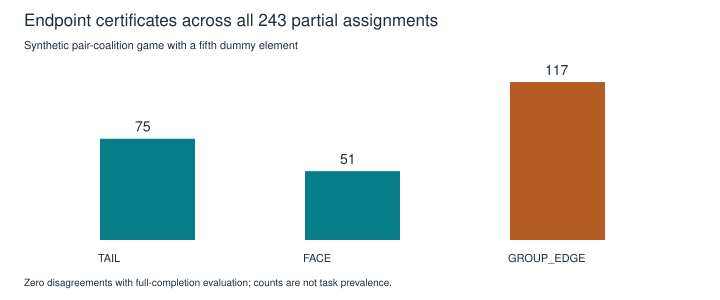
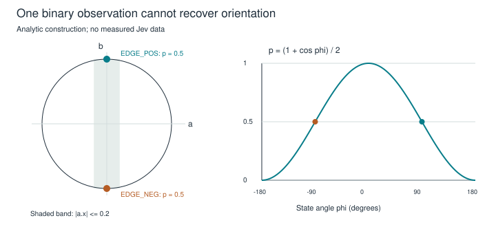

# Jev: uses, limits and the Coin Effect

**A usage atlas, mathematical audit and experimental program for majkee's science**

*Inner-circle research edition · 2026-11-03 · Oraculum, SHIFT_2. Literature and local-source synthesis with explicit derivations. No live Jev inference or task-performance experiment was performed.*

[Usage atlas](usage-atlas.md) · [Experiment cards](experiments.md) · [Implementer brief](implementer-brief.md) · [Evidence and review](../../../session/research-jev-usage/README.md)

**November 4 reading note:** the intake is closed. [Collection map and later chapters](README.md); [byte-preserved source archive](../../../session/research-jev-usage/archived-inputs/README.md). References below to `drafts/jev/` describe the original intake location.

## Abstract

Jev can contribute where a research process has a finite question, relevant evidence and an independently assessable outcome. This edition surveys those opportunities across the lab's compendium, then examines the proposed Coin Effect: binary element judgments, a third EDGE state, a coalition rule and selective question reformulation. The strongest immediate mathematical connection is partial evaluation of a monotone Boolean function. Its endpoint certificate is valid, but its interpretation, pivotal-element selection and empirical usefulness require separate arguments. A geometrical model can also make the rotating Boolean ball precise; it shows exactly which orientation information a single binary observation cannot recover. The proposed research proceeds from deterministic fixtures to controlled judgment experiments. Its output is an implementer-facing specification and test program, not a claim that the system is already useful or that a new logic has been discovered.

## 1. Research question and publication boundary

The operator asks where Jev can help his scientific and engineering practice, including unusual hypotheses that deserve serious tests. The earlier [Jev edition](../jev-judgment/study.md) supplied a bounded role comparison and an omission-review proposal. The new inputs are the three files under `drafts/jev/`: the September builder brief and the October mathematical and integration drafts. They contain proposals, historical capabilities and claims requiring correction.

The question is broader than brief checking: **which useful observations can Jev supply, which mathematical operations should consume them, and what would establish an advantage over simpler alternatives?** The [atlas](usage-atlas.md) covers every current compendium stream and adjacent use families. This is systematic coverage of a declared corpus, not a proof that every conceivable use has been found.

This is an operator-assigned internal edition. The [reading-room contract](../README.md) and [editorial evidence](../editorial-evidence.md) permit research publication independently of later adoption and gavel loops. Existing sources, decisions and the October edition remain unchanged. No `papers/` promotion, sibling implementation inspection or historical session takeover follows. The scientific assessments below are not a named Janus signature or a genuine cross-vendor review.

## 2. The instrument, refreshed

Current documentation lists Jev 1.14 and 1.13; a moving alias is unsuitable for a version-specific measurement study. Standard text limits are 64k per request and 32k for state plus a question; an opt-in long-context mode raises both to 262k. These are documentation observations, not tested local access. [TypeSafe models](https://docs.typesafe.ai/models).

| Interface | Appropriate research use | Interpretation boundary |
|---|---|---|
| Choice | Pick a supplied category, contrast, candidate or evidence relation | Categories need not be ordered. A forced option set may omit the appropriate answer. |
| Noul | Judge a precisely stated yes/no proposition | The reported yes probability is distinct from evidence completeness and measured accuracy. |
| Score | Rate an ordered, explicitly described rubric | Expected index is a coding of rubric levels, not automatically a physical magnitude. |
| Images and Box | Prototype diagram/object observations and localization | Experimental capability; does not supply pose, topology or metric geometry by itself. |

Sources: [Choice](https://docs.typesafe.ai/primitives/choice), [Noul](https://docs.typesafe.ai/primitives/noul), [Score](https://docs.typesafe.ai/primitives/score), [images](https://docs.typesafe.ai/images), [Box](https://docs.typesafe.ai/primitives/box). The models table labels input as text, while specific image documentation qualifies experimental support; preserve that distinction rather than silently choosing one description. Image input is documented for 1.13 and 1.14; Box requires 1.14. On TypeSafe's direct API both require the opt-in `TypeSafe-Danger-Zone-Images: true` header; this does not specify OpenRouter's request shape. Box is not part of the September three-type pilot contract.

Many questions can share one evidence state. Parallel evaluation is not statistical independence, and an adaptive question whose wording depends on a returned answer belongs to a later step. [Fan-out](https://docs.typesafe.ai/patterns/fan-out). The September brief's batching recommendation and the circuit's one-call-per-element wording should therefore be reconciled: batch questions whose wording does not depend on another answer when their evidence is shared, then measure whether speculative extra questions are worth their cost.

OpenRouter documents a distinct [Decisions endpoint](https://openrouter.ai/docs/api/api-reference/alphadecisions/submit-a-decisions-request); provider schemas and model identifiers must be kept separate from the direct TypeSafe API. No credentials, billing account, latency or successful response were tested here. Published token prices cannot settle total cost: evidence preparation, retries, reasoning calls and human review remain part of the experiment.

For a binary Choice, current documented confidence is `c=|2p−1|`, the same number as its top-two margin. More generally Choice confidence is `(p_max−1/n)/(1−1/n)`. It is a distribution statistic, not another independently observed estimate of correctness. [Confidence](https://docs.typesafe.ai/confidence). Consequently adding this binary confidence to a margin detector supplies no second signal. Score's confidence has different semantics and must not be substituted without an explicit contract.

Two current external reports make blanket calibration assumptions particularly inappropriate. Deußer et al. evaluate pinned Jev 1.13 across 37 datasets and sequential tasks; their results support some selective-prediction uses but show task and threshold dependence. They use frozen prompts and held-out threshold tuning, while acknowledging comparison and memorization limits. Single-step results do not establish sequential reliability. [Benchmark, v2](https://arxiv.org/html/2609.37647v2).

Porcedda's Sys1Cal examines recovery of known synthetic probabilities and proposes an unresolved-mass explanation of differences between primitives. Its own limitations call that explanation observational. Corrected point estimates and wider interval compatibility use different metrics; an improved interval score cannot be read as equivalent point accuracy. A pinned version and held-out correction split were not established in our inspected passages. [Sys1Cal-v1](https://arxiv.org/html/2609.35342v1). This is unusually relevant prior art for the Coin question, but it does not establish an internal third truth state. Our experiments test competing explanations.

## 3. Four objects that must remain distinct

Let `E` be supplied evidence, `q` a question, `r` a rubric, `m` a model and `Y~J_m(E,q,r)` the returned judgment. A controller validates Y; an interpretation produces an observation; a policy chooses a subsequent action. Neither validation nor the policy changes what was observed.

The Coin proposal involves four separable objects:

1. **World or problem state:** what the case actually is.
2. **Measurement:** what the evidence and Jev response reveal about that state.
3. **Representation:** FACE, TAIL, EDGE, orientation or geometric coordinates assigned by a declared rule.
4. **Decision:** accept, reject, defer, acquire evidence or reformulate.

A near-half binary output can result from incomplete evidence, ambiguity, conflicting sources, model error or a deliberately balanced stochastic problem. The same number does not distinguish those causes. Calling it EDGE creates a useful operational category if the decision rule needs one; it does not identify a new state of the underlying world.

Likewise, separate support and refutation observations can encode neither/support/refutation/both. That evidence protocol is not the same as probability near one half, an invalid receipt, a deadline or a physical coin on its rim. Retain these failure and evidence states separately.

The documented interface does not prohibit an explicit third Choice category. A category does not become ordered merely by receiving probability mass. The binary-derived EDGE and an explicitly defined third-class classifier answer different questions; the experiment should compare them when independently labeled third-class cases exist.

## 4. What the coalition mathematics establishes

### 4.1 Identity matters, but weighted thresholds are only one subclass

Let `v:2^N→{0,1}` satisfy `v(∅)=0`, `v(N)=1` and monotonicity. This defines a simple game, equivalently a normalized nonconstant monotone Boolean function. It need not be a weighted threshold function.

A small counterexample is

```text
v(x) = (x₁ AND x₂) OR (x₃ AND x₄).
```

Coalitions 12 and 34 win; 13 and 24 lose. If weights and quota q represented this game, adding the winning inequalities would give `Σwᵢ≥2q`, while adding the losing inequalities would give the same sum `<2q`: contradiction. A fifth dummy voter makes n odd without changing the argument. Odd group size resolves ties for ordinary majority; it does not impose complement decisiveness on every simple game.

The [coalition study](../coalition-evidence/study.md) already distinguishes richer coalition models from their weighted baseline. Its [historical card](../../../papers/card.choquet-consensus-gate.2026-07-02.md) makes adoption conditional on held-out benefit. The new Coin usage does not erase that condition. Minimal winning coalitions are a valid representation, but listing them can itself be large; a majority game has many minimal winners despite having a short threshold description.

### 4.2 The two-completion theorem

Let A contain known FACE elements and U the unresolved elements. Known TAIL elements are outside both. Every compatible completion S satisfies `A⊆S⊆A∪U`. Therefore

```text
v(A) ≤ v(S) ≤ v(A∪U).
```

If the endpoint values agree, every completion has that value. If they differ, the completion set contains both answers. This proves the certificate under the stated monotone, fixed-rule semantics. No independence probabilities, odd n, model calibration or rotation are required.

This is a special case of established ternary/hazard-free extension semantics: return a stable Boolean value when every resolution agrees, otherwise an unresolved value. [Ikenmeyer, Komarath and Saurabh, equation 1.1](https://eccc.weizmann.ac.il/report/2021/100/download). The endpoint shortcut follows here from monotonicity. It does not prove that every gatewise three-valued evaluation of an arbitrary circuit has the same semantics.

Monotonicity is essential: XOR has equal values at 00 and 11 but a different value at 01. Compatible completions matter too. If constraints exclude some assignments, disagreement of unconstrained endpoints may overstate uncertainty. Agreement remains a sound certificate over any compatible subset, provided the fixed coordinates and rule are sound; detecting disagreement precisely may need constraint reasoning.

The certificate is conditional on the assigned FACE/TAIL values. A confidently misclassified fixed predicate can produce a wrong but perfectly certified group answer. Structural correctness does not repair a measurement error. If the real target is exactly this fixed game of true predicates, a wrong determinate answer requires at least one incorrect assigned predicate. The union bound therefore gives `P(wrong and determinate) ≤ Σᵢ P(predicate i assigned incorrectly)` without independence. Rule misspecification requires another error term. This limited guarantee is not inherited calibration or a bound on conditional selective risk without accounting for coverage.

### 4.3 Finding pivotal elements is a separate problem

An unresolved element i is **potentially pivotal** when there exists `T⊆U\{i}` with

```text
v(A∪T)=0 and v(A∪T∪{i})=1.
```

Endpoint disagreement implies at least one such element: follow any chain adding unresolved elements one by one from the losing lower endpoint to the winning upper endpoint; some step changes the value. Conversely, a pivotal completion forces the endpoints to differ. This is an existential statement, not a claim that every unresolved element is pivotal in every completion.

This definition and chain proof use unrestricted Boolean completions. Under the constraint `x₁=x₂`, feasible states 00 and 11 can disagree while neither single-bit intermediate is feasible. Constraint-aware pivotality or acquisition must therefore be specified separately; an unconstrained potential pivot need not be a feasible isolated intervention.

For an all-unresolved AND of two inputs, each is potentially pivotal. Changing either alone from the all-zero endpoint does nothing. Thus single flips at one endpoint can miss useful observations. Two group evaluations establish uncertainty but do not return the full pivotal set. Exhaustive evaluation is acceptable for a tiny fixture; a larger system needs a declared representation and algorithmic cost.

Banzhaf swing counts count pivotal assignments under a specified averaging convention. They are not counts of prime implicants. For `f=x₁ OR (x₂ AND x₃)`, the derivative in x₁ is `NOT x₂ OR NOT x₃`: three satisfying assignments, two prime implicants. Power averaged over possible coalitions is also distinct from expected benefit of the next costly observation.

For majority seven with exactly four unresolved elements, let k of the three fixed elements be FACE. Then `0≤k≤3`, so `v⁻=0` and `v⁺=1`. Every unresolved element is potentially pivotal. The draft's example suggesting none commonly matters in that configuration is false for majority. A different rule may behave differently and must be named.



*Synthetic exhaustive fixture: the 243 partial assignments of the four-input pair rule with a fifth dummy element yield 75 fixed TAIL results, 51 fixed FACE results and 117 unresolved group results. Endpoint and full-completion evaluation agree in every case. These are counts of constructed configurations, not an estimate of real-case prevalence.*

## 5. What EDGE and orientation could mean

Three coarse states with two EDGE orientations produce four atomic cases: `{FACE, TAIL, EDGE_POS, EDGE_NEG}`. If orientation can be unobserved, its missingness requires another explicit representation. There is no reason to force this object into the conventional ordered `(j,k)` simple-game definition; that definition assumes ordered input grades. [Freixas and Zwicker](https://upcommons.upc.edu/entities/publication/ce299cbe-6842-47ef-bd0e-86fb713225fc).

There are three viable research interpretations:

| Interpretation | What EDGE means | What would establish value |
|---|---|---|
| Selective judgment | The current measurement does not justify commitment | Better error/coverage/effort trade-off than matched-budget baselines |
| Structured acquisition | A case needs a particular additional observation or reformulation | A pre-outcome orientation signal selects a better next action than fixed/random/cost-only routing |
| Richer state theory | The state possesses distinctions absent from the Boolean projection | Explicit operations and observations that distinguish competing state models |

The first two are buildable research proposals without settling the third. Selective classification is established prior art. [Geifman and El-Yaniv](https://proceedings.neurips.cc/paper/2017/hash/4a8423d5e91fda00bb7e46540e2b0cf1-Abstract.html). The acquisition interpretation connects to [stochastic Boolean function evaluation](https://arxiv.org/abs/2208.03810); assumptions about independent bits and exact tests do not automatically transfer to correlated, fallible language judgments.

An appropriate next-observation criterion is expected reduction in decision loss after seeing its outcome, less acquisition cost. Merely having a nonzero swing count is not enough: an observation may be expensive, unreliable, redundant or almost never decision-changing under the actual case distribution. Greedy guarantees require additional properties, such as those studied in [adaptive submodularity](https://arxiv.org/abs/1003.3967); they are not granted by the word “pivotal.”

Rephrasing can change the proposition instead of resolving it. Any resolution step must record whether it adds evidence, changes the measurement procedure, or creates a new predicate. The old group rule can be reused only when its inputs retain the promised meanings.

A near-tie's larger probability is not necessarily noise. Under correct probabilities, equal error costs and no reject action, choosing the larger probability minimizes expected classification error. Deferral becomes preferable only under a declared action/loss model. Nor must EDGE be rare: its useful rate depends on the task and acceptable risk, not a universal minority target.

## 6. A precise rotating Boolean ball

This is a proposed formalization for majkee to refine, not a claim to recover his complete intention. Let x be a unit vector and a,b orthogonal unit measurement axes. Define

```text
pₐ(x) = (1 + a·x)/2,
EDGE if |a·x| ≤ τ,     0 ≤ τ < 1,
orientation = sign(b·x), when b·x ≠ 0.
```

Outside the band, the sign of `a·x` supplies a binary reading. The linear probability map is a stipulated analytic observation model, not a measured law of Jev. At `b·x=0`, orientation is undefined and must not be guessed.

Reflect x across the plane perpendicular to b. Because `a·b=0`, the reflection preserves `a·x` and therefore pₐ, while reversing `b·x`. Two opposite orientations consequently produce exactly the same binary measurement. **Orientation is unidentifiable from that measurement alone.** An additional axis, sensor, contextual observation or recorded trajectory is necessary.

A passive rotation sends `(x,a,b)` to `(Rx,Ra,Rb)` for an orthogonal R; all displayed dot products remain unchanged. An active rotation of x with fixed axes can change the reading. Rotating the axes with x fixed changes the question. These are different experiments. Ordinary rotations preserve the sphere's topology; a claim of topological reconfiguration needs a specified change of state space, identifications, admissible paths or observation relation.



*Analytic illustration: x=(cos φ,sin φ,0), a=(1,0,0), b=(0,1,0). The two points at φ=±π/2 both give p=1/2 but have opposite orientation. This is not measured Jev behavior.*

The [stance study](../stance-geometry/study.md) supplies another legitimate geometry: categorical probabilities embed as `2√p` into a positive sphere orthant with the Fisher metric. That constrained geometry should not be identified with an unrestricted orientation sphere. A complete logic would additionally need operations, designated values and laws; a rotating representation alone does not provide conjunction, inference or truth semantics.

## 7. Research priorities and three reality assessments

**First:** evidence support and brief completeness. Both offer inspectable packets and later adjudication. The vendor already provides [citation-checking](https://docs.typesafe.ai/cookbooks/citation_check) and [passage-classification](https://docs.typesafe.ai/cookbooks/classifying_rag_passages) examples, so broad novelty claims fail the wheel check. The lab's possible contribution is its particular evidence contract and measured incremental benefit. Compare deterministic checks, repeat human review and a specialized grounding model such as [MiniCheck](https://aclanthology.org/2024.emnlp-main.499/).

**Second:** the Coin circuit as selective acquisition. Its theorem survives with explicit assumptions. The concrete path is a small, fully enumerated decision fixture followed by a measured semantic task. Its open obstacles are sound predicates, useful orientation, dependence and acquisition cost. The richer-ontology interpretation remains `THEORY`; the task-value question remains `OPERATIONALIZE`, not demonstrated readiness.

**Third:** stance and representation experiments. Use Jev as one measured observer and compare against known transformations and independent labels. Keep more ambitious tensor, propagation and control applications behind their observability tests. Experimental image capability makes diagram tests conceivable; it does not establish a rotation sensor.

The [experiment cards](experiments.md) predeclare contrasts, outcomes and failure interpretations. The [implementer brief](implementer-brief.md) specifies the minimal records and testable boundaries. No arbitrary count of fifty examples is treated as enough to decide every hypothesis.

## 8. Scope closure

This edition closes a bounded usage survey, mathematical correction and experiment-design assignment. The two-completion certificate and the orientation non-identifiability argument are explicit results under declared assumptions. They do not depend on buying a model call. Current documentation and external evaluations make Jev a plausible instrument for some semantic measurements, but local usefulness, calibration and economic benefit remain unmeasured.

<u>Recommendation: begin with a deterministic mathematical fixture and an evidence-review comparison; then test whether oriented acquisition earns an advantage over ordinary abstention. Preserve the richer state hypothesis until an experiment can distinguish it from its simpler alternatives.</u>

The remaining operator-facing question is the intended rotating-ball construction. The mathematical alternatives here permit a precise follow-up without requiring the present usage survey to pretend that ambiguity has been resolved.

## References and provenance

Primary sources are linked beside their claims; [sources.md](../../../session/research-jev-usage/sources.md) records reading depth and access limits. The main integrates read-only source, mathematical and mapping passes; [verification.md](../../../session/research-jev-usage/verification.md) records subsequent review and finite checks. All original drafts and historical editions are preserved. Figures are analytic or synthetic. No private account operations, paid inference, implementation release, cross-vendor signature or gavel occurred.
