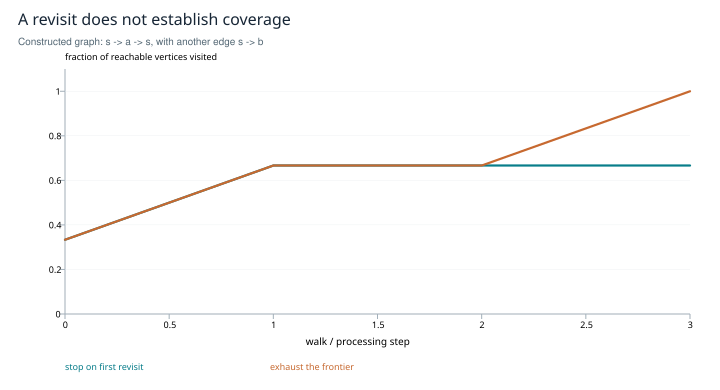

# File lineage, retrieval and the mental map

**Inner-circle research edition · SHIFT_1 evidence, SHIFT_2 synthesis and corrections · 2026-10-27**

## Abstract

A restarted agent can reconstruct working context from durable records, but fluent reconstruction does not establish fidelity to the past. This study separates event history, filtered views and three navigation postures: keyed lookup, exploratory probing and graph traversal. It preserves the original research's useful counterexample to stopping at the first revisited node, while correcting stronger claims about traversal, retrieval, concurrent writes and identity. Its practical contribution is a reproducible evaluation design for retrieval and historical reconstruction. No new agent experiments are reported.

## Research basis

The [memory architecture](../../../drafts/agent-memory-architecture.md), [reincarnation stone](../../../drafts/reincarnation-meditation-stone.md) and [mental-map seed](../../../drafts/mental-map-collective-mind.md) supply the questions. SHIFT_1 produced an [online literature leg](../../../session/research-mental-map/leg-online.result.2026-07-17.md), [formal leg](../../../session/research-mental-map/leg-offline-math.result.2026-07-17.md), [cross-measure](../../../session/research-mental-map/cross-measure.2026-07-17.md), [philosophy leg](../../../session/research-mental-map/leg-philosophy.result.2026-07-18.md), [draft card](../../../session/research-mental-map/card.mental-map.DRAFT.2026-07-19.md) and [composer amendment](../../../session/research-mental-map/card.amendment-A1.composer.2026-07-25.md). Their full bodies were read for this edition. The [manifest](../../../session/research-mental-map/corpus-manifest.md) records one cold-start observation and one identifier collision, not a controlled performance study.

## Theory: what persists

Let an append-only log L contain events with stable identifiers, provenance and timestamps. Let A be the identifiers added and T the identifiers suppressed by a read policy. The view `V(L) = A \ T` is a simple remove-once model. It preserves the underlying record while suppressing selected entries from a projection; it is not physical erasure. Two tombstone sets need not yield different views: suppressing different identifiers that never occur in A changes nothing. Distinct read policies therefore do not by themselves prove distinct identities.

The formal leg conflates two-phase and observed-remove sets. A two-phase set forbids re-adding a removed element; an observed-remove design associates removals with observed additions and has different concurrency semantics. An engineering specification must choose its semantics before claiming convergence. [Shapiro et al., 2011, §§3.3.2–3.3.5](https://www.lip6.fr/Marc.Shapiro/papers/2011/Comprehensive-CRDTs-RR7506-2011-01.pdf).

Preserving lineage enables an audit of reconstruction. It does not establish consciousness or personal continuity. HOLA supplies a narrower analogy: a compressed recurrent state can be supplemented by an exact cache of associations selected using prediction residuals. Its in-context experiments do not validate durable cross-session memory or surprise as a universal record-writing policy. [Cui, *A Hippocampus for Linear Attention*, 2026](https://arxiv.org/abs/2607.02303).

## Navigation and a corrected coverage theorem

The seed's ladder retrieves a keyed record; gravity explores a partly specified question; a deep dive maps related records. Keeping a trajectory of failed probes may help explain how an answer was reached. These are useful operational distinctions, but output arity does not prove that three separate tools or documents are mathematically necessary. A single typed interface can represent their different returns, and a mixed strategy may outperform any pure posture.

Consider the directed graph with edges `s→a`, `a→s`, `s→b`. The walk `s,a,s` encounters its own mark while b remains unseen. A revisit is not a coverage certificate. Conversely, a tree can be completely traversed without revisiting a node.

**Proposition.** In a fixed graph, let W contain s and only vertices reachable from s. If every successor of every vertex in W is also in W, then W is exactly the reachable set R(s).

**Proof.** Reachability of members gives `W ⊆ R(s)`. For any path from s, induction on path length and successor closure place every vertex on the path in W; hence `R(s) ⊆ W`. An empty worklist is a certificate only if the traversal has correctly enumerated and processed every successor. The worklist, marks and edge enumeration do not disappear because an outstanding-work count fits in one integer.

*Figure 1. Constructed example, not a measured crawl. A walk stops after `s,a,s` with two of three reachable vertices visited; a complete traversal also visits b. Coverage is relative to the declared fixed graph. A changing corpus or inaccessible edge creates a new boundary.*

The original formal leg correctly identifies the false-closure risk but incorrectly equates the first DFS/BFS revisit with frontier exhaustion. This edition retains the counterexample and replaces that equivalence with the proposition above.

## Retrieval and the write side

Exact lookup, sparse lexical ranking and dense learned retrieval have different error modes. They do not define a boundary between “RAG” and “not RAG”: generation informed by retrieved material can use lexical or dense retrieval. The foundational RAG system used dense retrieval; that choice is an implementation, not a universal definition. Adaptive retrieval also has prior art, including Self-RAG. [Lewis et al., 2020](https://arxiv.org/abs/2005.11401); [Asai et al., 2023](https://arxiv.org/abs/2310.11511).

Practitioner observations in the online leg do not establish universal accuracy or corpus-size thresholds. Query distribution, record structure and shared vocabulary affect performance. The composer amendment contributes a useful design hypothesis: better identifiers, source markers and extractive summaries can reduce retrieval ambiguity. Its identity-bearing versus mechanical composition split is a local design discipline, not an experimentally established law about which model family may summarize a record.

<u>Freeze a query set with independently labeled relevant records. Compare exact lookup, sparse ranking and candidate alternatives at a fixed retrieval budget, measuring recall, answer support, latency and cost. Stratify exact-key, paraphrase and multi-record questions.</u> Version the corpus, retrieval method and scoring rubric. Measure vocabulary drift and composition backlog separately from query failure. A reduction in backlog is not automatically an improvement in answers.

## Concurrent writes and reconstruction tests

The [recorded duplicate-ID incident](../../../drafts/2026-07-17-epoch-gavel-id-collision.md) involved appending without first reading existing identifiers. Separately, a check-then-act race is possible when two writers read the same maximum identifier and select its successor. Serializing the complete read–assign–append transaction is sufficient under that model. Non-overlapping wall-clock intervals are not a necessary condition for every collision-free execution, and the original universal sequential-ID/concurrency/lock-free impossibility claim is unproved. Atomic allocation primitives change the model. Linux `O_APPEND` atomically combines end-of-file positioning with an individual write, but does not itself allocate a sequential record identifier; network filesystems require additional care. [Linux `open(2)`](https://man7.org/linux/man-pages/man2/open.2.html).

An anchor test compares a reconstructed account with held-out historical evidence. It measures agreement under a rubric, not honesty, intent or the truth of every historical claim. External graders can share biases. <u>Commit a reconstruction before revealing held-out propositions; score agreement, contradiction and abstention using independent raters, including known, omitted and intentionally revised beliefs as controls.</u> Report rater agreement and sample selection. Calling the score “historical fidelity” keeps the observable separate from moral or identity interpretations.

## Practical study and remaining evidence

<u>Evaluate graph coverage on fixed graphs with branches and cycles, then evaluate the navigation selector on held-out queries; treat selector thresholds and mixed strategies as empirical choices.</u> The source variables for coverage, query width, cost and sufficiency change meaning between the formal leg and later card. A trial must define them consistently rather than inherit their symbols.

The full format-preference experiment, selector calibration, anchor validation and comparative retrieval trial remain unperformed in the inspected corpus. The [cross-vendor brief](../../../session/research-mental-map/leg-crossvendor.brief.md) has no corresponding result file. This informed SHIFT_2 synthesis cannot replace that blind leg. The publication closes a conceptual and methodological scope; it does not claim empirical effectiveness or trigger later project alignment.
