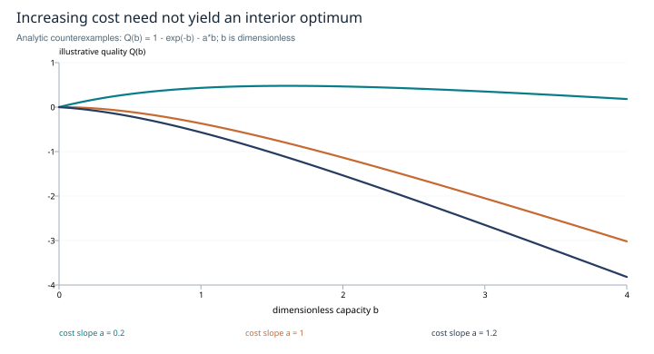

# Scratch instruments: compression, representation and commitment

**Inner-circle research edition · SHIFT_1 evidence, SHIFT_2 synthesis and corrections · 2026-10-27**

## Abstract

Handwriting motivates questions about intermediate representations, but human motor cognition does not automatically transfer to an agent. This study separates selection, representation, working status and spatial arrangement. It preserves SHIFT_1's two-part research shape: a mechanism map and a testing protocol. Anti-anchoring remains a testable explanation, while forced compression remains a named hypothesis. We correct an overly broad sketch-first novelty claim and a mathematical claim that rising anchoring cost guarantees a useful interior scratch budget. No budget sweep or agent-performance result is reported.

## Research basis and mechanism map

The [original handwriting impulse](../../../drafts/handwriting-analogue.md), [online leg](../../../session/research-handwriting/leg1-online.epoch.2026-07-18.md), [formal leg](../../../session/research-handwriting/leg2-offline.color.2026-07-18.md), [cross-measure](../../../session/research-handwriting/cross-measure.2026-07-18.md) and [manifest](../../../session/research-handwriting/run-manifest.md) were read in full, together with both leg briefs and the staged cross-vendor brief. They distinguish four candidate interventions.

**Selection.** A short intermediate may preserve essentials, omit a decisive exception or merely rephrase the task. A direct replication and mini-meta-analyses did not support a general immediate-learning benefit from longhand's encoding in their tested setting. This does not settle every note-taking context; it blocks treating forced compression as an established general cause. [Urry et al., 2021](https://doi.org/10.1177/0956797620965541).

**Representation.** Tables, diagrams and prose expose different relations and constraints. Their effects on a model require measurement. Human EEG findings cannot establish an analogous agent mechanism, and neural connectivity differences alone do not prove improved learning. [Van der Weel and Van der Meer, 2024](https://www.frontiersin.org/journals/psychology/articles/10.3389/fpsyg.2023.1219945/full); [Pinet and Longcamp, 2025](https://www.frontiersin.org/journals/psychology/articles/10.3389/fpsyg.2024.1517235/full).

**Working status.** A scratch can be non-binding while preserved for audit. Deleting an archival copy after the final generation cannot change that already-produced answer. Storage duration and the model's instructions about commitment are separate variables.

**Spatial arrangement.** A sketch can expose relationships but can also add rendering errors and cost. Visualizing Thought already uses self-generated conceptual diagrams within planning. The historical assertion that sketch-first reasoning is absent is therefore too broad. A particular canvas, prose-output task or controlled status intervention may still be untested. [Borazjanizadeh et al., 2025](https://arxiv.org/abs/2503.11790).

Short intermediates also have direct prior art. Sketch-of-Thought reports token savings under tested conditions; results differ across tasks and versions. This does not establish that imposing a hard cap universally improves quality. [Aytes et al., EMNLP 2025](https://aclanthology.org/2025.emnlp-main.1236/).

## Theory: why an optimum is not guaranteed

The formal leg models quality as `Q(B) = F(B) − A(B)`, where B is intermediate capacity, F is useful retained information and A is downstream anchoring cost. This is a proposed explanatory model, not a measured law. Even if F saturates and A increases, the best B can be zero, at an endpoint or interior. An interior differentiable optimum requires a balance of marginal effects and appropriate curvature or a sign change; the presence of anchoring alone does not locate it.

For a constructed example let `F(b)=1−exp(−b)` and `A(b)=a·b`, for b≥0 and a>0. Then `Q′(b)=exp(−b)−a` and `Q″(b)=−exp(−b)<0`. If 0<a<1, the unique maximum is `b*=−log(a)`; if a≥1, the maximum is at b=0. If a=0 there is no finite maximum on the unbounded domain. Thus an increasing cost can accompany an interior maximum or make every positive budget worse. Here b is dimensionless: it is not a token count or mutual-information measurement.

*Figure 1. Analytic illustration of the stated functions, not agent data. The curves use a=0.2, 1 and 1.2. They refute a universal interior-optimum inference; they do not estimate a useful prompt budget.*

The source also compares a budget in tokens with information in bits. These require an explicit coding model to relate quantitatively. No universal 20–30-token rule follows. Nor does an inverted-U curve uniquely identify anti-anchoring: several mechanisms can produce the same shape. A flat curve does not prove that scratch was ignored.

## Testing protocol

<u>Test scratch budget and representation as separate controlled interventions before combining them.</u> Freeze tasks spanning single-insight, multi-constraint and rare-detail cases, with independent rubrics. Use the same model, original task, final-answer allowance and decoding settings, and randomize repeated trials across these arms:

| Arm | Intervention | Main comparison |
|---|---|---|
| N | Direct answer, no requested visible scratch | Baseline |
| C(B) | Non-binding intermediate with predeclared cap B, then separately budgeted answer | Budget response |
| U | Same intermediate instruction without the cap | Constraint effect |
| Diagram/text pair | Diagram-first versus text-outline-first, matched as closely as feasible for information and cost | Representation effect |

Blind raters to condition. Score substantive correctness, critical-detail loss and surface quality separately; record tokens, latency, failures and model version. Visible scratch is not a complete record of hidden model computation. Diagram comparisons may add search, calls and rendering stages, which must be reported as confounders or controlled.

For n paired tasks, estimate `Δ(B) = mean_i [score(answer_i,C(B)) − score(answer_i,N)]`. Plot contrasts with task-level uncertainty intervals and a separate critical-error rate. Predeclare budgets and hypotheses; evaluate a selected budget on held-out tasks. A small feasibility sample estimates variability but need not resolve modest effects.

<u>To test anchoring specifically, manipulate whether the intermediate resembles a polished answer or an abstract structure, and measure copying together with correctness.</u> Overlap alone is not harmful anchoring: it may preserve a correct fact. Keep the task's essential constants and exceptions visible in every arm.

## Parked hypothesis and closure

SHIFT_1 explicitly parked forced compression as the primary mechanism and retained anti-anchoring as conditional. Preserve that distinction. Failure of the predicted budget curve can motivate revisiting the parked explanation, but is not automatic evidence for it.

Scratch is a task-level intervention, not proof of persistent identity, changed weights or a stable conversational style. The scientific gaps are controlled budget sweeps, mechanism-specific tests and representation comparisons. The [cross-vendor brief](../../../session/research-handwriting/leg-crossvendor.brief.md) remains without its intended result in the current local corpus. This publication supplies a corrected mechanism map and a testable protocol; later project alignment and approvals are separate work.
