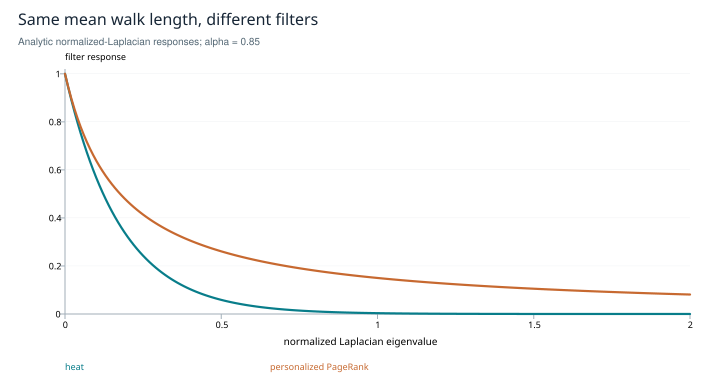

# Retrieval over a graph that can be rebuilt

**Diffusion, approximation and the boundary between records and coordinates**

*Research edition 1 · 2026-10-27 · SHIFT_2 synthesis of SHIFT_1's released spectral-core card. Theory and analytic illustration; no new retrieval benchmark is claimed.*

## Abstract

A graph can retrieve records through relationships that a single pairwise similarity score does not express. That opportunity depends on how its edges are constructed, how a query enters the graph and what counts as relevant evidence. This study defines heat and PageRank retrieval under a common convention, distinguishes spectral sparsification from low-rank filtering, and resolves the supposed conflict between append-only records and changing spectral coordinates. The result is an implementable research design with explicit approximation and evaluation boundaries. Existing document-retrieval results motivate the approach; they do not establish its performance on agent records.

## 1. Scope and recovered result

SHIFT_1 released a spectral-core instrument card after revising its edge rule and recording downstream ownership boundaries. Its strongest reusable result is the separation of canonical records from derived graph structure. The present study concerns that mathematical and computational interface. Historical project assignments are provenance only; no other repository was inspected.

Three claims need narrowing. Graph diffusion does not universally outperform vector retrieval on multi-hop tasks. Spectral clustering does not guarantee semantic coherence or connected output. A low-rank approximation is not, by that fact, a spectral sparsifier. These corrections leave a useful instrument with a testable benefit.

## 2. Define the graph before interpreting the spectrum

Let W be the symmetric, nonnegative weighted adjacency matrix of a finite undirected graph. Let `D = diag(W1)` and `L = D − W`. Then

```text
xᵀLx = Σ_{i<j} Wᵢⱼ(xᵢ − xⱼ)² ≥ 0.
```

The combinatorial Laplacian is positive semidefinite. A normalized Laplacian changes the weighting of states and the meaning of its spectrum. Degree-zero nodes need an explicit policy. In the random-walk formulation below, each isolated node receives a self-loop so that the transition matrix is stochastic.

We use column probability vectors and `P = W D⁻¹` on positive-degree nodes. Each column of P sums to one. A seed q is nonnegative and sums to one. It may come from lexical matches, an embedding query or a declared mixture; that choice is part of the method, not an invisible preprocessing step.

The edge construction has three separately measured layers: explicit structural links, declared vocabulary co-occurrence, and optional similarity neighbors. A citation or reply is evidence of a recorded relation, not proof of semantic relevance. An embedding-derived edge makes embeddings part of graph construction even when later ranking uses graph operators.

On a connected positive-degree component with n vertices, smooth coordinates can be obtained from the generalized eigenproblem `Ly=λDy`, excluding the constant mode. For k coordinate columns, `1≤k≤n−1`, the corresponding subspace minimizes `tr(YᵀLY)` subject to `YᵀDY=I` and `YᵀD1=0`. Coordinate bases are not unique; if the cutoff splits a repeated eigenspace, the selected subspace is also nonunique. Clustering those coordinates adds a separate algorithm and a choice of cluster count. Neither operation proves semantic coherence, and disconnected components require explicit handling [R5].

## 3. Heat and restart walks answer different questions

With the above convention, two probability-preserving retrieval operators are

```text
h_t = exp[−t(I − P)] q,              t ≥ 0
    = exp(−t) Σ_{k≥0} (t^k / k!) P^k q,

r_α = (1 − α)(I − αP)⁻¹ q
    = (1 − α) Σ_{k≥0} α^k P^k q,       0 ≤ α < 1.
```

Heat mixes walk lengths with a Poisson distribution; personalized PageRank uses a geometric distribution. Their mean walk lengths are t and `α/(1−α)`, respectively. Matching those means does not make the operators equal. For an undirected graph they can be analyzed through the similar symmetric normalized operator. Diffusion distance compares transition profiles; it is related to, but distinct from, the activation score of one seeded query [R1].



*Figure 1. Analytic filter responses on the normalized Laplacian spectrum: heat `exp(−tλ)` and restart `(1−α)/(1−α+αλ)`, with α = 0.85 and t = α/(1−α). The figure illustrates different smoothing behavior; it is not a relevance or latency benchmark.*

HippoRAG uses a knowledge graph and personalized PageRank for its tested retrieval tasks [R2]. That is relevant prior art. It does not demonstrate that the same construction, edge semantics or parameters work best for every file-backed agent archive. The question here remains an empirical comparison on a specified corpus.

The Atlas also invoked associative memory through the connection between a specified modern Hopfield update and attention [R6]. That result concerns a particular model and update rule. It does not identify every external graph-retrieval operator, a tokenizer or an entire agent's semantic dynamics with one common energy landscape. Here heat and restart walks are defined directly, without requiring that identification.

## 4. Two approximations with different promises

A spectral sparsifier is a sparse weighted graph with Laplacian L̃ such that, for all x,

```text
(1 − ε)xᵀLx ≤ xᵀL̃x ≤ (1 + ε)xᵀLx,       0 < ε < 1.
```

Effective-resistance sampling is one established route to such a graph [R3]. This is a statement about preserving quadratic forms across directions. It is not a semantic denoising theorem.

By contrast, low-rank truncation discards spectral modes. If v is a discarded unit eigenvector with positive eigenvalue λ, then `vᵀLv = λ` while the truncated quadratic form is zero. The lower sparsifier bound fails. This short counterexample settles the terminology error in the original atlas and card. Low-rank filtering may still be useful; it must carry its actual approximation target and error measure.

A polynomial approximation to a graph filter can act on q without computing a full eigendecomposition. Chebyshev methods provide an established construction [R4]. For degree K and a sparse matrix, the leading work is K sparse matrix-vector products, approximately `O(K(|E|+|V|))` for one signal. Error depends on the chosen filter, spectral interval and degree. Lanczos offers another matrix-function approximation route. No universal crossover scale follows from the algorithm name alone.

## 5. Append-only records, versioned derived views

An immutable record log and a recomputed graph are compatible. The invariant concerns the source history, not every cache derived from it. Appending a node may change degrees and therefore existing normalized weights. A cached result can remain attributable to an earlier snapshot while a new graph is built.

<u>Recommendation — expose a project-neutral retrieval result with record identifiers, source-snapshot identifier, graph-construction version, seed method, filter parameters and approximation tolerance.</u>

The implementation choices are full recomputation, partial eigensolvers, incremental methods, warm starts or query-time filtering. Dense full decomposition is typically cubic; it is not the cost of every spectral method, and it is not evidence that incremental approaches are impossible. Choose the simplest adequate method after measuring update frequency, graph size, latency and acceptable staleness.

## 6. A test that can close the application question

Use a fixed corpus and questions with adjudicated supporting records. Split by source or session to reduce leakage. Compare lexical retrieval, vector retrieval where available, structural-graph-only retrieval, heat, PageRank and a hybrid at matched retrieval and evidence budgets. Include both single-hop and multi-hop questions, because a mixed average can conceal opposite effects.

Report support recall, ranking quality, contradictory evidence retrieved, and answer-support sufficiency separately from latency and update cost. Also record graph density, disconnected components, high-degree hubs, layer weights and cache age. Ablate the three edge layers. Measure connectedness if it matters, rather than declaring every spectral cluster coherent.

<u>Recommendation — retain a simpler retrieval baseline unless the graph method improves a preregistered evidence-quality measure at an acceptable cost. Treat an empty or fragmented structural graph as a measured corpus property.</u>

## 7. Scope closure and limitations

No performance measurements were collected in this edition. The theoretical scope is closed by the operator definitions, approximation distinction and versioned-view design. The next empirical result may be a win, a tradeoff or no benefit; all three are publishable answers to the bounded question.

## References and provenance

- **R1.** Coifman, R. R., and Lafon, S. *Diffusion maps*. Applied and Computational Harmonic Analysis 21, 2006. [Publisher](https://www.sciencedirect.com/science/article/pii/S1063520306000546). Checked for the diffusion-distance construction; not a claim about this archive.
- **R2.** Gutiérrez, B. J., et al. *HippoRAG: Neurobiologically Inspired Long-Term Memory for Large Language Models*. NeurIPS 2024. [Paper](https://arxiv.org/abs/2405.14831). Checked method and stated evaluation scope; benchmark results are not transferred here.
- **R3.** Spielman, D. A., and Srivastava, N. *Graph Sparsification by Effective Resistances*. [Paper](https://arxiv.org/abs/0803.0929). Checked all-vectors quadratic-form guarantee.
- **R4.** Defferrard, M., Bresson, X., and Vandergheynst, P. *Convolutional Neural Networks on Graphs with Fast Localized Spectral Filtering*. NeurIPS 2016. [Paper](https://arxiv.org/abs/1606.09375). Checked polynomial-filter construction; no claim that its learning benchmarks validate this retrieval design.
- **R5.** von Luxburg, U. *A Tutorial on Spectral Clustering*. [Paper](https://arxiv.org/abs/0711.0189). Used for the graph-normalization and relaxed-partition setting; no semantic guarantee is inferred from clustering.
- **R6.** Ramsauer, H., et al. *Hopfield Networks is All You Need*. [Paper](https://arxiv.org/abs/2008.02217). Used for its specified attention/update connection, not a universal equivalence between memory systems.
- **Local provenance.** [Atlas №1, Part II](../../../drafts/orchestration-atlas-v2.md), [released spectral card](../../../papers/card.spectral-engine-core.2026-07-02.md), [split-map](../../../session/split-map.2026-07-02.md), [provenance map](../provenance.md).

*Verification date: 2026-10-27. Research edition; no new implementation or external adoption is claimed.*
