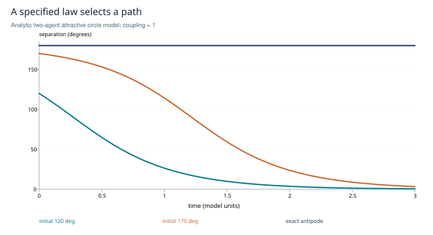
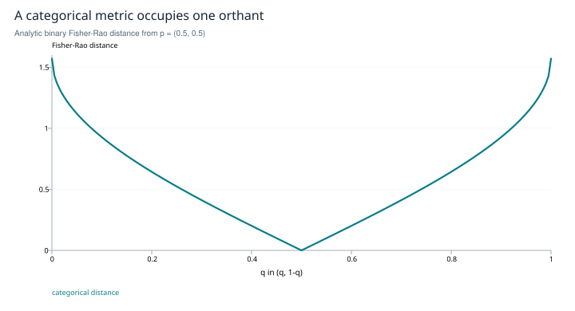

# Stance geometry: what the sphere can carry

**A bounded study of opposition, reconciliation and categorical evidence**

*Research edition 1 · 2026-10-27 · SHIFT_2 synthesis of SHIFT_1 research by Nabla, majkee and the lab's research legs. Historical source material is preserved. This edition is a theoretical synthesis with analytic illustrations; it reports no new agent experiment.*

## Abstract

An agent's position can be represented as a direction, but geometry does not by itself make that direction a meaningful stance. This study separates four questions: what rotations preserve; what a specified interaction law predicts; how categorical probabilities acquire spherical geometry; and how different representation frames can be compared. The resulting mathematics is usable under stated assumptions. The stronger claim that these constructions form one validated logic of agent disagreement is unsupported. We give a solved two-agent model, derive the categorical metric, retain the earlier rejection of an unrestricted Dempster–Shafer weld, and specify the measurements needed before applying the model. The scope closes with a typed construction and a falsifiable implementation approach, not a claim of empirical superiority.

## 1. Question and evidence boundary

The question is whether curved geometry supplies operations and predictions that improve our understanding of agent disagreement. SHIFT_1's Atlas №2 proposed three forks: static spherical operations, stance-flow, and a simplex–sphere bridge. Its research retained the first and third conditionally, found a governing-law literature for the second, and rejected the original all-in-one sheaf synthesis as typed. The later decision ledger accepted those verdicts. This study carries those results forward.

The literature check is targeted, not an exhaustive novelty search. No claim that an application is universally absent is made. Primary sources establish mathematical constructions and particular reported experiments; they do not establish that embeddings from this lab measure stance reliably.

## 2. A stance is a measurement before it is a point

Let a proposed measurement map send a text and question to a nonzero vector, then normalize it to a state x in the unit sphere S^(d−1). Its Euclidean inner product gives angular distance `d(x,y) = arccos(xᵀy)`. This construction preserves a chosen coordinate geometry. It does not show that a semantic contradiction maps to the antipode −x.

Two distinct facts are useful. An orthogonal frame change R preserves the metric because `(Rx)ᵀ(Ry) = xᵀy`. The antipodal operation is equivariant because `R(−x) = −Rx`. The second identity does not prove the first, and neither supplies truth values, conjunction or entailment. An involution is only one algebraic property of negation.

The geometry must follow the task. A bipolar agree–disagree scale is naturally an interval; joining its endpoints into a circle changes its meaning. A periodic phase with positive strength may use a cylinder with log-strength. A shared categorical distribution is a third object. These are modeling choices, not interchangeable pictures.

**Correction to the earlier survival test.** A spherical Fréchet mean minimizes a weighted sum of squared angular distances. Its nonlinear behavior can differ from normalizing an arithmetic mean. But the complete Gram matrix of a finite configuration determines that configuration up to an orthogonal transformation in a common ambient dimension; “not recoverable from pairwise cosines” is therefore too strong. Intrinsic means can be nonunique, particularly for symmetric or antipodal configurations; any selection rule must be specified. The useful test is performance against an explicit comparator under the same information budget, not an impossible independence from the geometry's own distances.

## 3. A law that selects motion

Consider the following deliberately restricted model: two identical agents on a circle, no natural-frequency difference, symmetric attractive coupling κ > 0, and continuous time. Set δ = θ₂ − θ₁ on the branch 0 ≤ δ ≤ π. Their angular separation obeys

```text
θ̇₁ = κ sin(θ₂ − θ₁),       θ̇₂ = κ sin(θ₁ − θ₂)
δ̇ = −2κ sin δ
δ(t) = 2 arctan[tan(δ₀/2) exp(−2κt)],   0 ≤ δ₀ < π.
```

This is an analytic example of the classical attractive circle model, not a reproduction of every generalized spherical model. The published generalized Kuramoto work permits richer, model-specific equilibria [R1]. Its early online date was October 2024; its journal issue was January 2025.

For our chosen law, `E = κ(1 − cos δ)` gives `Ė = −2κ² sin²δ ≤ 0`. Consensus is stable in relative separation; the exact antipode δ = π is stationary and unstable to a relative perturbation. Exact opposition does not spontaneously choose a direction. An initial perturbation, noise model or intervention must provide symmetry breaking.



*Figure 1. Analytic illustration, κ = 1. The 120° and 170° initial separations approach consensus; an exact 180° separation remains stationary. The curves are evaluations of the displayed equation, not observed conversations. CSV values accompany the figure.*

Geodesic ambiguity is a boundary-value issue. On a sphere, distinct non-antipodal points have a unique shortest geodesic; allowing longer windings changes the path count. Given an initial position and velocity, the geodesic initial-value problem is locally unique. Thus “the reconciliation path contains information” must mean a measurable association between path features and an independently specified outcome. Geometry alone does not establish that association.

The hairy-ball theorem concerns continuous tangent vector fields on even-dimensional spheres. It does not guarantee a permanently immovable agent in a time-varying, coupled multi-agent system. That interpretation requires a separate dynamical argument.

## 4. Categorical geometry with the scale restored

Let p be a strictly positive probability vector over m shared categories, with coordinates summing to one. Tangent changes satisfy `Σ dpᵢ = 0`. The categorical Fisher metric is

```text
ds² = Σ (dpᵢ)² / pᵢ.
φ(p) = (2√p₁, …, 2√pₘ),       ||φ(p)|| = 2.
||dφ||² = Σ (dpᵢ)² / pᵢ.
d_FR(p,q) = 2 arccos[Σ √(pᵢqᵢ)].
```

This supplies the factor that the original substrate missed: the isometric image is the positive orthant of a radius-2 sphere, with boundary points obtained by limits [R2]. The pullback of the unit-sphere metric under `√p` is one quarter of the stated Fisher metric; distances scale by one half. The orthant is not the whole sphere and has no antipodal categorical pair. Its maximal distance is π, reached between different pure categories in the closure.



*Figure 2. Analytic illustration: distance from p = (0.5, 0.5) to q = (q, 1−q). Endpoints are limiting values. This curve shows a metric, not a demonstrated improvement in stance detection.*

For instance, `(0.9, 0.1)` and `(0.1, 0.9)` have distance `2 arccos(0.6) ≈ 1.85459`. A computational check can recover this value without any agent data. A useful evaluation must separately establish category agreement, calibration and an outcome that the metric predicts.

A Dempster–Shafer basic mass assignment distributes mass over nonempty subsets of a hypothesis set. It is a probability vector in a larger simplex, so a square-root embedding of that vector is possible. However, this embedding alone does not encode subset intersections, conflict normalization or the combination rule. The earlier rejection is retained: embedding a mass vector is not a derivation of Dempster's rule from Fisher geometry. Restricting to ordinary categorical probabilities avoids that particular type mismatch; it does not automatically validate any aggregation rule.

## 5. Comparison across frames

In a linear cellular sheaf, each vertex and edge carries a vector space; linear restriction maps compare incident vertex states. A sphere can be a constrained state set inside a vector space, but it cannot simply replace the vector-space stalk while keeping all linear machinery unchanged. Discourse sheaves supply a useful model of frame-dependent comparison [R3].

With chosen Euclidean inner products, write the comparison residual as `Bx`, and the sheaf Laplacian as `BᵀB`. Its kernel always contains zero. Consequently, “no global section” is not the right statement of conflict for this homogeneous model. The practical question is whether specified observations admit a consistent extension under pinned, affine or normalization constraints. Constraining those states makes the question nontrivial.

Relative representations offer an established way to compare encodings through common anchors [R4]. The follow-up on bootstrapping anchors is a separate paper [R5]. These works motivate a candidate measurement design; they do not prove that all vendors share one orthogonal semantic frame. Unequal representation dimensions, anchor selection and held-out directional preservation all require explicit treatment.

## 6. Implementation approach and decisive tests

### Results recovered by the full SHIFT_1 comparison

**Equal opposition has a dimension requirement.** For N>1 unit vectors with common off-diagonal inner product c, `||Σvᵢ||²=N+N(N−1)c≥0`, hence `c≥−1/(N−1)`. Equality means the common-angle configuration is centered. Its Gram matrix has eigenvalues 0 on the all-ones direction and N/(N−1) on the other N−1 directions, so it needs ambient dimension at least N−1. The maximal common angle is `arccos(−1/(N−1))`: 180°, 120° and about 109.47° for N=2,3,4. Equidistance alone does not imply this bound is attained: orthonormal vectors are equidistant at 90°. Nor does sum-zero alone imply equal pairwise angles. This restores Color's capacity result with both necessary hypotheses explicit. It is a capacity bound for this particular arrangement, not a count of how many semantically distinct opinions an embedding can represent.

The Epoch leg associates this with spherical codes, equiangular tight frames and softmax rank bottlenecks. These are relevant but distinct problems: equal negative signed inner products are stronger than equal absolute inner products, and a softmax output-rank limit is not the same as the regular-simplex bound. [Godey et al., *Why do small language models underperform? Studying Language Model Saturation via the Softmax Bottleneck*](https://arxiv.org/abs/2404.07647) supplies model-capacity prior art, not empirical validation of the proposed stance limit.

**Measurement has prior negative evidence.** The original Epoch leg warned about prompt/paraphrase sensitivity and consensus dynamics. Its cited [NAACL 2024 opinion-dynamics study](https://aclanthology.org/2024.findings-naacl.211/) reports a bias toward accurate information under its simulated conditions, with prompt interventions changing dynamics. This supports measuring elicitation effects; it does not prove every model or prompt collapses to consensus. Stability across paraphrases and sensitivity to instructed social roles belong in the measurement experiment.

**Frame synchronization is borrowed mathematics.** [Singer and Wu's vector diffusion maps](https://arxiv.org/abs/1102.0075) provide the connection-Laplacian lineage for orthogonal comparisons. The [SHIFT_1 follow-up](../../../session/research-atlas2-stance-geometry/leg-epoch-followup.2026-07-02.md) explicitly classifies that mathematical repair as established and the cross-vendor stance application as open. Preserving retrieval neighbors is not the same validation target as preserving a named semantic contrast direction. Measure both; do not convert a neighbor-retrieval score into a stance-alignment theorem. This distinction does not claim that all alignment methods were evaluated only on nearest neighbors.

**A complete spherical logic remains an open construction.** The original research asked for operations analogous to negation, conjunction and aggregation with explicit axioms. An antipodal involution and a geometric mean do not supply such a logic. This edition closes their geometric analysis, while retaining the logic question as unresolved; the historical search did not prove universal absence.

<u>Recommendation — define a project-neutral stance-measurement interface before selecting geometry: question, text, timestamp, category schema, representation version, uncertainty and provenance.</u>

The minimum empirical study has three separate outputs. First, repeated measurements on paraphrases and known opposition pairs estimate stability and semantic validity. Second, a fitted motion model is tested on held-out trajectories against persistence and simple endpoint baselines. Third, categorical distances are compared on a preregistered task against ordinary probability baselines. Split by question or session so near-duplicate turns do not leak across training and evaluation.

<u>Recommendation — require a held-out task benefit over the same-information baseline; report uncertainty, failure examples and sensitivity to dimension, prompts and anchors.</u>

For a numerical prototype, store raw texts immutably and derive versioned states. Implement the analytic two-agent fixture before fitting any multi-agent law. Check norm preservation, energy descent in the specified attractive model, exact-antipode behavior and the categorical distance formula. These are construction checks, not proofs that a conversation follows the model. No downstream project or model vendor is assigned this work.

## 7. Scope closure and limitations

The theoretical scope is closed: rotations preserve declared geometry; a specified law yields testable motion; categorical Fisher geometry has a corrected scale and a restricted domain; and linear comparison across frames has explicit types. The unrestricted unification is rejected. Empirical benefit for agent disagreement remains unmeasured in this reconstruction. A failed stance-measurement test would be a substantive negative result, not a reason to decorate the model with more geometry.

## References and provenance

- **R1.** Zhang, Z., Al-Abri, S., and Zhang, F. *A generalized Kuramoto model for opinion dynamics on the unit sphere*. Automatica 171, 111957, 2025; online 2024-10-02. [Publisher](https://doi.org/10.1016/j.automatica.2024.111957), [author-institution publication record](https://researchportal.hkust.edu.hk/en/publications/a-generalized-kuramoto-model-for-opinion-dynamics-on-the-unit-sph/). Checked: bibliographic record, abstract and accessible model/stability discussion; no claim of reproducing its general theorem.
- **R2.** Miyamoto, H. K., Meneghetti, F. C. C., Pinele, J., and Costa, S. I. R. *On Closed-Form Expressions for the Fisher–Rao Distance*. [Version 3](https://arxiv.org/html/2304.14885v3). Checked: categorical/spherical construction; the local derivation above makes its convention explicit.
- **R3.** Hansen, J., and Ghrist, R. *Opinion Dynamics on Discourse Sheaves*. [Full text](https://arxiv.org/html/2005.12798). Checked: linear comparison maps, global sections and diffusion, including collapse to zero when nontrivial sections are absent.
- **R4.** Moschella, L., et al. *Relative representations enable zero-shot latent space communication*. ICLR 2023. [arXiv:2209.15430](https://arxiv.org/abs/2209.15430). Checked: identity and reported anchor-based representation method; no transfer of its benchmark claims to stance data.
- **R5.** Cannistraci, I., et al. *Bootstrapping Parallel Anchors for Relative Representations*. 2023. [arXiv:2303.00721](https://arxiv.org/abs/2303.00721). Checked: identity and abstract; this is not R4.
- **Local provenance.** [Original substrate](../../../drafts/atlas2-research-substrate.md), [cross-measure](../../../session/research-atlas2-stance-geometry/cross-measure.2026-07-02.md), [Color derivations](../../../session/research-atlas2-stance-geometry/leg-color.2026-07-02.md), [Epoch follow-up](../../../session/research-atlas2-stance-geometry/leg-epoch-followup.2026-07-02.md), [ledger](../../../session/flag.md), [study provenance map](../provenance.md). These document SHIFT_1's work and its later acceptance; they are not prerequisites for reading this study.

*Verification date: 2026-10-27. Figures and tables in this edition are synthetic or analytic unless explicitly identified otherwise.*
