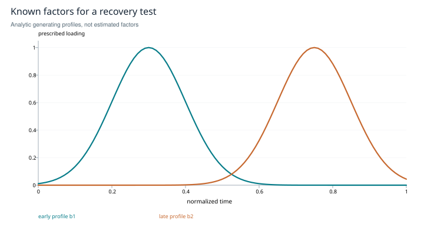

# Patterns in the record

**Tensor analytics with an explicit observation model**

*Research edition 1 · 2026-10-27 · SHIFT_2 synthesis of SHIFT_1's released tensor-log card. Mathematical construction and synthetic factors; no new archive decomposition is claimed.*

## Abstract

An agent–time–concept array can separate recurring patterns across participants, time and vocabulary. Its usefulness depends on the meaning of a cell, the observation mask, the chosen concept axis and the identifiability of the factorization. This study defines CP and Tucker models, corrects a confusion between tensor order and rank, and shows why permuting the entire time axis cannot test temporal structure through ordinary reconstruction error. The output is a standalone analysis design with explicit null models and validation criteria. Factors remain descriptive coordinates until evidence supports stronger interpretations about agent contributions or redundancy.

## 1. Scope and inherited finding

SHIFT_1 released an offline analytics card with a useful dependency boundary: concept coordinates must come from somewhere. A declared vocabulary gives a simple starting point; graph-derived clusters are a richer candidate that inherits the graph's calibration questions. This study preserves that boundary and does not require a downstream implementation to exist.

The question is whether a chosen representation of records contains reproducible multiway structure beyond simple activity counts. It is not whether a factorization can draw an attractive map. Any sufficiently flexible model can fit patterns that have little scientific meaning.

## 2. The array is an observation design

Let `X[a,t,c]` measure a declared quantity for agent a, aligned time bin t and concept c. Examples include counts of explicit tags or a normalized, versioned concept score. Those are different measurement scales. Turns need a common alignment rule; each agent's private “turn 5” is not automatically the same time coordinate.

Record an eligibility and observation mask Ω. An observed zero, a missing measurement and a structurally impossible event are different states. Fit and test only on appropriately eligible observations, and describe how missingness could depend on the process. Unequal exposure can dominate apparent agent factors unless it is modeled or normalized explicitly.

A three-axis array is an **order-3 tensor**. Its CP rank is not necessarily three. CP represents an approximation as

```text
X̂[a,t,c] = Σ_{r=1}^R A[a,r] B[t,r] C[c,r].
```

Tucker instead uses a core `G[i,j,k]` and three factor matrices, summing over their separate latent coordinates. Its multilinear rank is a tuple. These distinctions and their computational consequences are established in the tensor literature [R1].

## 3. What a factor can and cannot mean

For one CP component, multiplying a column of A by s and dividing the corresponding column of B by s leaves the reconstructed tensor unchanged. Components can also be permuted. Additional uniqueness requires assumptions; numerical stability under noise is another question. Tucker permits basis changes compensated by the core. A factor's orientation is therefore not intrinsically a causal explanation.

The following synthetic construction makes the limits visible. Choose two nonnegative temporal profiles

```text
b₁(t) = exp[−(t−0.30)² / 0.02],
b₂(t) = exp[−(t−0.75)² / 0.02],       0 ≤ t ≤ 1,
```

and combine them with declared agent and concept loadings in the CP formula. The two phases exist because we put them there. Recovering them from masked noisy observations is a controlled identification test; showing the generating curves alone is not a recovered result.



*Figure 1. Analytic generating factors, not fitted factors. A future recovery test should vary exposure, noise and missingness while holding the generating structure known. CSV values specify the displayed profiles.*

Similarity between fitted agent factors may reflect common assignments or exposure. It does not establish that one agent is redundant. Likewise a shift in the concept axis can be a representation change rather than a change in behavior.

## 4. A shuffle that cannot answer the intended question

Let Π permute every time slice in the same way, and permute the observation mask consistently. If factors A, B, C approximate X, then A, ΠB, C approximate the permuted tensor with the same residual norm. The set of ordinary CP models of rank R is invariant under that permutation. The analogous statement holds for Tucker.

Consequently, the infimum reconstruction error, the minimum when attained, and representable rank cannot distinguish the original order from a common time-axis permutation. Unconstrained CP approximation need not attain a best low-rank fit. The permutation invariance still holds exactly. The original card's shuffled-tensor suggestion is therefore insufficient if reconstruction fit is the statistic.

An order-sensitive claim needs an order-sensitive statistic: prediction of held-out future observations, temporal smoothness under an explicitly temporal model, or a defined cross-agent lead–lag relation. Its null must disrupt that relation while preserving relevant marginal structure and observation patterns. Independent circular shifts or justified within-block permutations are candidates, not universal recipes; stationarity and boundary assumptions must be stated.

## 5. What the cited applications establish

InfTucker introduces a nonlinear probabilistic tensor model. It uses a sender–receiver–date–content array as an introductory illustration, but its Enron experiment uses a three-way sender–receiver–email representation [R2]. That supports communication-log tensor modeling as prior art; it does not validate this study's agent–time–concept representation.

Multi-Dictionary Tensor Decomposition supplies a way to incorporate dictionaries, including graph-derived side information [R3]. It motivates a possible coupling between graph and tensor views. It does not show that arbitrary clusters are a semantically valid concept axis.

## 6. Implementation approach

<u>Recommendation — define a project-neutral tensor dataset with record provenance, agent exposure, aligned time bins, concept-schema version, cell units and explicit eligibility/observation masks.</u>

Start with declared vocabulary. Test known synthetic factors under structured missingness, then compare ordinary count summaries, matrix models and tensor models on held-out eligible observations. Select rank with held-out loss, multiple initializations and stability after component alignment. Core-consistency diagnostics can inform particular CP models; they are not a universal rank oracle for every Tucker fit.

For a temporal claim, reserve future periods before choosing rank or vocabulary. Ordinary CP alone cannot predict an unseen time row: forecasting requires a specified extrapolation model, temporal covariates or dynamic factor law. Keep held-out-cell completion separate from future-row forecasting. Report the actual order-sensitive statistic against a justified null. For a role interpretation, compare against task mix and exposure rather than treating factor similarity as a verdict on participants.

<u>Recommendation — treat a change from vocabulary coordinates to graph clusters as a new measurement edition requiring validation, even if the same factorization routine accepts both arrays.</u>

## 7. Scope closure

The study closes the model and measurement questions: order, rank, masks, invariances and the temporal null are explicit. It supplies a viable offline analysis path without claiming recovered causal roles. Whether the archive contains stable, useful structure remains an empirical question. That question can be answered negatively without invalidating the mathematical construction or erasing the earlier instrument release.

## Atlas router branch

### Atlas router branch: a distinct use of bilinear algebra

Atlas I.2 also proposes scoring a task q against an agent descriptor k using `s(q,k)=qᵀWk`, with compatible dimensions. This is a bilinear form for fixed W; projecting queries and keys before a dot product gives the same form with `W=W_QᵀW_K`. Applying softmax converts scores into normalized weights but does not calibrate them as probabilities of success. This router proposal is separate from CP/Tucker decomposition of a log, and a successful factorization does not validate routing. <u>Fit any scoring parameters on training tasks and evaluate routing utility, calibration and load effects on held-out tasks against a fixed or lexical baseline.</u> The Atlas mapping is retained as an untested proposal, not a claim of a new algebraic primitive.

## References and provenance

- **R1.** Kolda, T. G., and Bader, B. W. *Tensor Decompositions and Applications*. SIAM Review 51(3), 455–500, 2009. [Author-hosted paper](https://www.kolda.net/publication/TensorReview.pdf). Checked CP/Tucker definitions and ambiguity/uniqueness distinctions. The permutation argument above is derived directly.
- **R2.** Xu, Z., Yan, F., and Qi, Y. *Infinite Tucker Decomposition: Nonparametric Bayesian Models for Multiway Data Analysis*. [Paper](https://arxiv.org/abs/1108.6296). Checked introductory example versus the actual communication-data experiment; no replication performed.
- **R3.** McNeil, M., and Bogdanov, P. *Multi-Dictionary Tensor Decomposition*. [Paper](https://arxiv.org/abs/2309.09717). Checked dictionary/side-information scope; no assumption that its empirical results transfer to agent records.
- **Local provenance.** [Atlas №1, I.2](../../../drafts/orchestration-atlas-v2.md), [released tensor card](../../../papers/card.tensor-log-analytics.2026-07-02.md), [provenance map](../provenance.md).

*Verification date: 2026-10-27. Numerical fitting and empirical temporal tests are not reported in this edition.*
